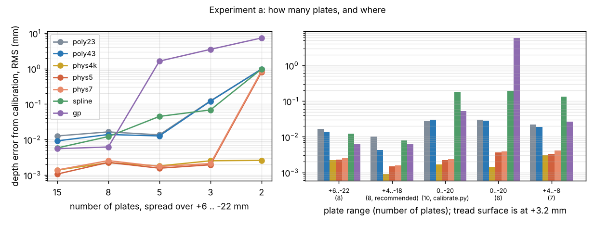
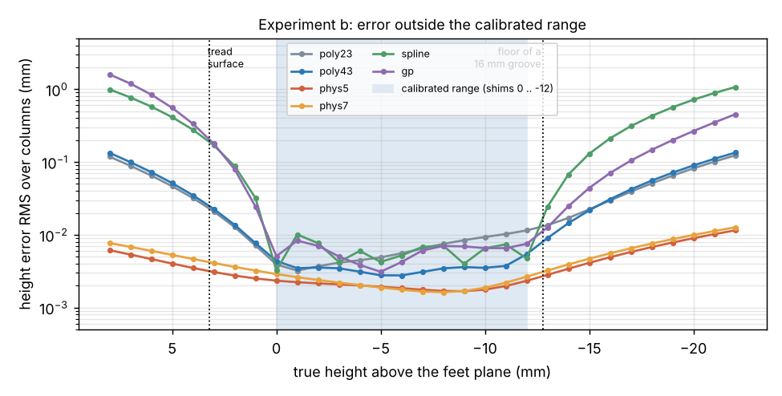
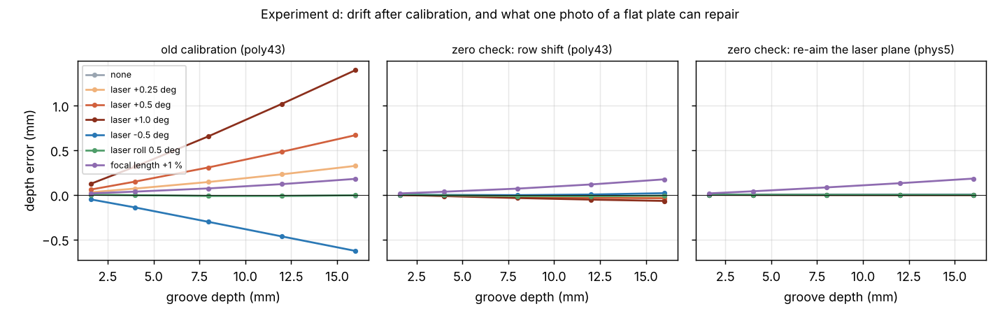
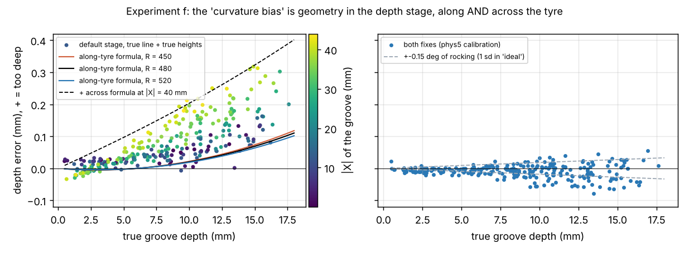

# Calibration: px -> mm model and bench procedure (branch `research/calibration`)

Simulation only (the real photos carry no calibration data). Everything here is reproducible from
`research/` with `OMP_NUM_THREADS=1 python -m experiments.calibration.<script>`; each script writes one
table to `experiments/calibration/out/` and, for a / b / d / f, one figure to `notes/figs/calibration/`.

**How the numbers are measured.** Unless a table says "harness", the error is *calibration-only*: plates are
rendered and their line extracted with the baseline (as a student would), a model is fitted, and it is then
evaluated on the **exact** laser line of a flat surface at +3.2 mm (where the tread sits) and of a flat
floor 1.6 / 4 / 8 / 12 / 16 mm below it, over columns 20..300. "RMS / max" are over those 5 depths x 71 columns.

## Short answers

| | question | answer (numbers below) |
|---|---|---|
| 1 | which model | **Physical model with free principal point (`phys7`, 7 numbers)**, with the 20-coefficient polynomial fitted alongside as a cross-check. With 15 good plates every sensible model is already below 0.02 mm: the model matters when plates are few, off-range, mislabelled, or the laser moves. |
| a | how many plates | Physical: 3 are enough (0.002 mm RMS). poly(4,3): needs >= 5 (0.013), fails at 3 (0.12). Spline / GP need >= 8. **Use 8.** |
| b | extrapolation | Plates 0..-12 only, 16 mm groove: phys 0.004 mm RMS, poly 0.030 (max 0.07), spline / GP 0.17-0.20. |
| c | shim errors | All models carry a label error into depth about 1:1 at worst; the physical model takes about a quarter off random label errors and is ~6x better (phys5) against tilted plates. A 1 % caliper scale error is a 1 % depth error for every model. |
| d | drift | A laser knock is a **scale** error: +4.2 % per 0.5 deg (0.67 mm at 16 mm). One photo of a flat plate at 0 mm reads -1.72 mm per 0.5 deg (repeatability 0.002 mm), so it detects 0.01 deg, and re-aiming the laser plane from that one photo removes the error (0.003 mm left). A lens change (+1 % focal) is invisible at 0 mm: it needs a second, deep plate. |
| e | benchmark | Swapping only the calibration model changes nothing (ideal 0.147 -> 0.155). What the physical model *enables* is a depth stage in mm: ideal MAE 0.147 -> **0.081**, true-line ceiling 0.071 -> **0.015**. Stress gets slightly worse with the Steger line (1.516 -> 1.565). |
| f | "curvature bias" | It is two effects. The tyre-radius term is only 0.08 mm at 16 mm; a larger term (0.10 mm) comes from fitting the tread per image column (perspective x cross-crown). Both belong in the **depth stage**, not the calibration. Assuming R = 480 for a 450 / 520 mm tyre costs 0.005 mm. |

## 1. Models (`algos/calib_models.py`)

All have `fit(u, v, z)` and `height(u, v)`. `polyAB` = degree A in u, B in v (`poly43` is the harness default,
`poly23` is what `pipeline/calibrate.py` fits). `phys4` = no distortion; `phys5` = k1, lens height, laser
angle, roll, offset; `phys7` = + principal point. `spline` = per-column cubic spline through the plates.
`gp` = Gaussian process (RBF + white) on a bilinear trend, 400 points.

15 plates, 3 re-photographed sets (GP: 1), leave-one-plate-out cross-validation (`models_cv.py`):

| model | free numbers | fit RMS mm | CV interior RMS mm | CV end plates RMS mm | depth err RMS mm | depth err max mm |
|---|---|---|---|---|---|---|
| poly11 | 4 | 0.784 | 0.715 | 1.839 | 1.026 | 1.505 |
| poly12 | 6 | 0.274 | 0.254 | 0.404 | 0.191 | 0.479 |
| poly22 | 9 | 0.066 | 0.064 | 0.204 | 0.067 | 0.133 |
| poly23 | 12 | 0.023 | 0.023 | 0.042 | 0.012 | 0.030 |
| poly43 | 20 | 0.019 | 0.019 | 0.036 | 0.009 | 0.018 |
| poly65 | 42 | 0.017 | 0.019 | 0.037 | 0.003 | 0.011 |
| poly87 | 72 | 0.017 | 0.020 | 0.101 | 0.005 | 0.016 |
| phys4 | 4 | 0.273 | 0.251 | 0.382 | 0.168 | 0.472 |
| phys5 | 5 | 0.018 | 0.018 | 0.018 | 0.001 | 0.002 |
| phys7 | 7 | 0.018 | 0.018 | 0.018 | 0.001 | 0.002 |
| spline | 75 | 0.017 | 0.020 | 0.082 | 0.006 | 0.017 |
| gp | 400 | 0.019 | 0.019 | 0.029 | 0.006 | 0.012 |

- Under-fitting is obvious (poly11, poly12, poly22, and phys4 = no lens distortion: 0.17-1.0 mm).
- Over-fitting does **not** show in the fit residual or in interior cross-validation (all ~0.018-0.020 mm, which
  is the line noise: 0.03 px x 0.47 mm/px). It shows only when a model must leave its plates: the end-plate
  column is 0.018 for the physical model, 0.036 for poly43, 0.082 for the spline, 0.101 for poly87.
- **Focal length cannot be calibrated from flat plates**: scaling f by s, k1 by s^2 and re-aiming the plane gives
  exactly the same heights. So f is fixed at the data-sheet value. Measured: a lens 5 % longer than the data
  sheet changes nothing (0.001 mm, table in section "is the physical model too lucky").

The model (excerpt 1, the forward function: pixel -> 3-D point on the laser plane):

```python
def xyz(self, u, v, p=None):
    p = p or self.p
    xd, yd = (u - p["cx"]) / self.f_px, (v - p["cy"]) / self.f_px
    x, y = xd, yd
    for _ in range(6):                                     # undo the distortion (fixed-point iteration)
        k = 1 + p["k1"] * (x * x + y * y)
        x, y = xd / k, yd / k
    st, ct, sr, cr = np.sin(p["theta"]), np.cos(p["theta"]), np.sin(p["roll"]), np.cos(p["roll"])
    b = np.array([0.0, -st, -ct])                          # beam centre direction
    xr = np.array([cr, sr * ct, -sr * st])                 # fan axis
    n = np.cross(b, xr)                                    # laser-plane normal
    # ray P = C + t*(x, -y, -1), C = (0, 0, Zc);  plane n.(P - A) = 0, A = (0, y0, pz)
    t = (n[1] * p["y0"] + n[2] * (self.pz - p["Zc"])) / (n[0] * x - n[1] * y - n[2])
    return x * t, -y * t, p["Zc"] - t                      # X across the tread, Y along it, Z = height
```

and the fit (excerpt 2), which is also the one-photo "re-aim" used in d:

```python
def _solve(self, u, v, z, free):
    def resid(q):
        return self.xyz(u, v, {**self.p, **dict(zip(free, q))})[2] - z      # mm
    r = least_squares(resid, [self.p[k] for k in free], x_scale=[self.SCALE[k] for k in free])
    self.p.update(dict(zip(free, map(float, r.x))))

def refit_plane(self, u, v, z=0.0, pivot_z=90.1):     # ONE plate: camera kept, laser turned about its exit
    m = PhysModel(self.free, self.w, self.h, self.f_px, dict(self.p))
    m.p["y0"] = self.p["y0"] + (pivot_z - self.pz) * np.tan(self.p["theta"])   # same plane, anchored at the exit
    m.pz = pivot_z
    return m._solve(u, v, np.full(len(u), float(z)), ("theta", "roll"))
```

Fitted on the 15 `calib` plates it returns k1 = -0.1200, Zc = 84.92 mm, theta = 34.98 deg (truth -0.12, 85, 35).

### Is the physical model too lucky? (`g_mismatch.py`)

The simulator's camera *is* this model (pinhole + k1, principal point exactly at the centre, exact laser
plane). So the lens was made less ideal by wrapping `holder_sim.project` (no edit of `sim/`):

| simulated lens | plates | poly23 RMS / max | poly43 RMS / max | poly65 RMS / max | phys5 RMS / max | phys7 RMS / max | spline RMS / max |
|---|---|---|---|---|---|---|---|
| simulator lens (k1 only, centred) | 15 | 0.013 / 0.031 | 0.010 / 0.019 | 0.004 / 0.013 | 0.001 / 0.002 | 0.001 / 0.003 | 0.006 / 0.019 |
| simulator lens (k1 only, centred) | 8 | 0.011 / 0.030 | 0.005 / 0.013 | 0.006 / 0.018 | 0.002 / 0.003 | 0.002 / 0.004 | 0.006 / 0.019 |
| focal length 5 % longer than the data sheet | 15 | 0.009 / 0.021 | 0.007 / 0.017 | 0.004 / 0.011 | 0.001 / 0.002 | 0.001 / 0.002 | 0.006 / 0.011 |
| focal length 5 % longer than the data sheet | 8 | 0.008 / 0.026 | 0.004 / 0.013 | 0.006 / 0.022 | 0.002 / 0.004 | 0.003 / 0.006 | 0.005 / 0.016 |
| principal point off by (6, -4) px | 15 | 0.014 / 0.034 | 0.009 / 0.019 | 0.005 / 0.017 | 0.026 / 0.118 | 0.002 / 0.006 | 0.009 / 0.020 |
| principal point off by (6, -4) px | 8 | 0.013 / 0.036 | 0.005 / 0.017 | 0.004 / 0.010 | 0.030 / 0.127 | 0.002 / 0.009 | 0.010 / 0.019 |
| + second radial term k2 = +0.05 | 15 | 0.011 / 0.024 | 0.010 / 0.018 | 0.004 / 0.017 | 0.010 / 0.026 | 0.011 / 0.027 | 0.006 / 0.019 |
| + second radial term k2 = +0.05 | 8 | 0.006 / 0.015 | 0.005 / 0.014 | 0.006 / 0.022 | 0.010 / 0.025 | 0.010 / 0.027 | 0.007 / 0.025 |
| + tangential distortion p1 = p2 = 0.003 | 15 | 0.013 / 0.030 | 0.009 / 0.018 | 0.005 / 0.015 | 0.032 / 0.131 | 0.001 / 0.003 | 0.006 / 0.014 |
| + tangential distortion p1 = p2 = 0.003 | 8 | 0.012 / 0.035 | 0.008 / 0.019 | 0.010 / 0.023 | 0.040 / 0.137 | 0.005 / 0.007 | 0.007 / 0.018 |
| all of the above | 15 | 0.009 / 0.018 | 0.008 / 0.013 | 0.004 / 0.016 | 0.037 / 0.122 | 0.009 / 0.025 | 0.007 / 0.026 |
| all of the above | 8 | 0.005 / 0.013 | 0.004 / 0.013 | 0.005 / 0.015 | 0.039 / 0.135 | 0.009 / 0.025 | 0.008 / 0.018 |

**`phys5` (principal point fixed at the image centre) is the model that breaks**: 0.03-0.04 mm RMS, 0.13 max,
as soon as the optical centre is a few pixels off or the lens has tangential distortion. `phys7` stays at
<= 0.011 RMS / 0.027 max, about level with poly43. That is why the recommendation is `phys7`, not `phys5`,
and why the polynomial should be kept as a cross-check. Not tested: a laser line that is not a plane
("smile"), which a cheap line laser can have; the polynomial would absorb it, the physical model would not.

## a. Number of plates and range (`a_plates.py`, figure a)

5 re-photographed sets (GP: 1). Polynomial degree in v is cut to (plates - 1) when there are fewer than 4.
`phys4k` = physical model with the lens height fixed at the CAD value (85 mm).

| plates (+6..-22) | poly23 RMS / max | poly43 RMS / max | phys4k RMS / max | phys5 RMS / max | phys7 RMS / max | spline RMS / max | gp RMS / max |
|---|---|---|---|---|---|---|---|
| 15 | 0.013 / 0.033 | 0.009 / 0.019 | 0.001 / 0.004 | 0.001 / 0.003 | 0.001 / 0.005 | 0.006 / 0.023 | 0.006 / 0.012 |
| 8 | 0.016 / 0.049 | 0.014 / 0.032 | 0.002 / 0.007 | 0.002 / 0.005 | 0.003 / 0.006 | 0.012 / 0.035 | 0.006 / 0.017 |
| 5 | 0.014 / 0.033 | 0.013 / 0.038 | 0.002 / 0.006 | 0.002 / 0.006 | 0.002 / 0.007 | 0.045 / 0.084 | 1.625 / 2.494 |
| 3 | 0.123 / 0.249 | 0.121 / 0.230 | 0.003 / 0.009 | 0.002 / 0.006 | 0.002 / 0.010 | 0.068 / 0.110 | 3.490 / 4.996 |
| 2 | 0.972 / 1.261 | 0.970 / 1.250 | 0.003 / 0.010 | 0.796 / 1.077 | 0.854 / 1.107 | 0.970 / 1.250 | 7.316 / 10.917 |

| range (plates) | poly23 RMS / max | poly43 RMS / max | phys4k RMS / max | phys5 RMS / max | phys7 RMS / max | spline RMS / max | gp RMS / max |
|---|---|---|---|---|---|---|---|
| +6..-22 (8) | 0.016 / 0.049 | 0.014 / 0.032 | 0.002 / 0.007 | 0.002 / 0.005 | 0.003 / 0.006 | 0.012 / 0.035 | 0.006 / 0.017 |
| +4..-18 (8, recommended) | 0.010 / 0.031 | 0.004 / 0.015 | 0.001 / 0.004 | 0.001 / 0.003 | 0.002 / 0.005 | 0.008 / 0.023 | 0.006 / 0.020 |
| 0..-20 (10, calibrate.py) | 0.028 / 0.053 | 0.030 / 0.066 | 0.002 / 0.005 | 0.002 / 0.006 | 0.002 / 0.008 | 0.181 / 0.231 | 0.053 / 0.108 |
| 0..-20 (6) | 0.030 / 0.067 | 0.028 / 0.091 | 0.001 / 0.005 | 0.004 / 0.013 | 0.004 / 0.011 | 0.194 / 0.268 | 5.859 / 6.729 |
| +4..-8 (7) | 0.022 / 0.094 | 0.019 / 0.078 | 0.003 / 0.010 | 0.003 / 0.013 | 0.004 / 0.021 | 0.135 / 0.353 | 0.027 / 0.158 |



- 6-10 hand shims is plenty for the physical model and adequate for poly43 **if the range brackets the work**.
- With 2 plates nothing identifies both lens height and laser angle (0.8 mm) unless the lens height is taken
  from CAD (`phys4k`: 0.003 mm). That relies on CAD being right; 1 mm of lens-height error is ~1.2 % of depth
  (inferred from geometry, not measured).
- **Range matters more than count.** Shims under the feet can only give heights <= 0, but the tread surface is
  at about +3.2 mm (the crown rises between the feet). The `calibrate.py` recipe (10 shims, 0..-20) therefore
  extrapolates at every tread-surface point: polynomials 0.028-0.030 RMS (3x worse than with plates above 0),
  spline 0.18. The simulator's `calib` set hides this because it contains +2, +4, +6 mm plates.
- The GP is a negative result: with <= 5 plates the fitted length scale collapses between plates (1.6-7 mm).

## b. Interpolation vs extrapolation (`b_extrapolation.py`, figure b)

Plates 0, -2, ..., -12 only; 5 sets. The 16 mm groove has its surface at +3.2 and its floor at -12.8 mm.

| model (plates 0..-12) | 8 mm groove: bias | max | 16 mm groove: bias | RMS | max | height RMS at +3 mm | height RMS at -18 mm |
|---|---|---|---|---|---|---|---|
| poly23 | -0.004 | 0.050 | -0.006 | 0.030 | 0.071 | 0.021 | 0.051 |
| poly43 | -0.004 | 0.065 | -0.008 | 0.030 | 0.069 | 0.023 | 0.055 |
| phys5 | 0.000 | 0.006 | -0.002 | 0.004 | 0.009 | 0.003 | 0.007 |
| phys7 | 0.001 | 0.008 | -0.002 | 0.005 | 0.018 | 0.004 | 0.008 |
| spline | 0.186 | 0.222 | 0.171 | 0.172 | 0.207 | 0.169 | 0.429 |
| gp | 0.180 | 0.328 | 0.172 | 0.201 | 0.338 | 0.178 | 0.147 |



## c. Errors in the shims (`c_shim_errors.py`)

8 plates (+6 .. -22, every 4 mm). Cells: depth error RMS / max / mean bias at 16 mm (mm). GP left out (too slow
for the trials).

| error in the shims | poly23: RMS / max / bias@16 | poly43: RMS / max / bias@16 | phys5: RMS / max / bias@16 | phys7: RMS / max / bias@16 | spline: RMS / max / bias@16 |
|---|---|---|---|---|---|
| none | 0.018 / 0.044 / -0.014 | 0.016 / 0.032 / -0.016 | 0.002 / 0.004 / -0.004 | 0.003 / 0.005 / -0.004 | 0.011 / 0.022 / -0.008 |
| calipers: every label +-0.05 mm (sd, 20 trials) | 0.027 / 0.089 / -0.006 | 0.026 / 0.089 / -0.008 | 0.019 / 0.060 / -0.010 | 0.020 / 0.068 / -0.011 | 0.053 / 0.139 / +0.004 |
| one stack 0.2 mm off (the -10 plate) | 0.047 / 0.096 / +0.073 | 0.045 / 0.079 / +0.070 | 0.038 / 0.051 / +0.043 | 0.038 / 0.054 / +0.042 | 0.079 / 0.174 / +0.057 |
| one stack 0.2 mm off (the -22 end plate) | 0.052 / 0.103 / -0.057 | 0.051 / 0.097 / -0.059 | 0.019 / 0.029 / +0.010 | 0.019 / 0.029 / +0.010 | 0.011 / 0.022 / -0.003 |
| base shim 0.2 mm off (every plate below -2) | 0.136 / 0.245 / +0.221 | 0.134 / 0.229 / +0.219 | 0.118 / 0.176 / +0.175 | 0.117 / 0.182 / +0.173 | 0.133 / 0.201 / +0.181 |
| all labels 1 % too big (calipers / units) | 0.086 / 0.170 / +0.146 | 0.085 / 0.155 / +0.144 | 0.096 / 0.157 / +0.156 | 0.096 / 0.159 / +0.156 | 0.090 / 0.156 / +0.152 |
| the -10 plate tilted 0.5 deg along Y | 0.034 / 0.071 / -0.041 | 0.033 / 0.059 / -0.043 | 0.015 / 0.020 / -0.018 | 0.015 / 0.020 / -0.019 | 0.034 / 0.074 / -0.028 |
| the -10 plate tilted 0.5 deg along X | 0.092 / 0.245 / -0.020 | 0.091 / 0.250 / -0.022 | 0.009 / 0.032 / -0.006 | 0.007 / 0.024 / -0.007 | 0.129 / 0.465 / -0.013 |
| every plate tilted 0.5 deg, random direction (10 trials) | 0.172 / 0.831 / +0.012 | 0.173 / 0.823 / +0.009 | 0.028 / 0.108 / +0.006 | 0.080 / 0.464 / +0.013 | 0.263 / 1.000 / +0.016 |

- Random caliper error (0.05 mm sd per plate): 0.019 (phys) vs 0.026 (poly) vs 0.053 (spline). Fewer free
  numbers average the labels; the spline reproduces every label error exactly.
- One wrong stack: 0.04-0.05 mm for every model if it is in the middle; at the end of the range the
  polynomial bends to it (0.052) and the physical model does not (0.019).
- Systematic errors (a wrong base shim under every deeper plate; calipers reading 1 % long) go straight through
  **every** model: 0.12-0.14 mm RMS and +0.15 mm at 16 mm. No model can detect them. Only a reference of known
  height (a gauge block, or a step block of known depth) can.
- Tilted plates are where the physical model wins clearly: one plate tilted 0.5 deg across the tread costs
  poly43 0.25 mm max, phys 0.03; every plate tilted randomly 0.5 deg: poly43 0.17 RMS / 0.82 max, phys5
  0.028 / 0.108. (phys7 is worse here, 0.080 / 0.46: the free principal point soaks up some of the tilt.)

## d. Drift after calibration (`d_drift.py`, figure d)

**1. Old poly43 calibration on the drifted device (exact line, flat surface +3.2 mm)**

| drift | offset a (mm) | scale b | error @1.6 | @8 | @16 | spread across columns @16 |
|---|---|---|---|---|---|---|
| none | -0.003 | -0.06 % | -0.000 | -0.013 | -0.007 | 0.013 |
| laser +0.25 deg | -0.012 | +2.04 % | 0.028 | 0.143 | 0.323 | 0.011 |
| laser +0.5 deg | -0.020 | +4.23 % | 0.058 | 0.306 | 0.667 | 0.009 |
| laser +1.0 deg | -0.034 | +8.84 % | 0.124 | 0.655 | 1.395 | 0.006 |
| laser -0.5 deg | 0.015 | -4.02 % | -0.053 | -0.304 | -0.629 | 0.016 |
| laser roll 0.5 deg | -0.003 | -0.05 % | -0.000 | -0.013 | -0.007 | 0.656 |
| focal length +1 % | -0.009 | +1.12 % | 0.015 | 0.071 | 0.178 | 0.028 |

**2. Zero check read with the old phys5 calibration**

| drift | 0 mm plate reads (mm) | tilt across 300 px (mm) | -12 mm plate reads error (mm) | difference (-12) - (0) |
|---|---|---|---|---|
| none | -0.006 | 0.007 | -0.001 | 0.005 |
| laser +0.25 deg | -0.846 | -0.003 | -1.101 | -0.255 |
| laser +0.5 deg | -1.722 | 0.002 | -2.233 | -0.511 |
| laser +1.0 deg | -3.532 | 0.014 | -4.596 | -1.064 |
| laser -0.5 deg | 1.635 | -0.003 | 2.109 | 0.473 |
| laser roll 0.5 deg | -0.004 | 1.716 | -0.000 | 0.004 |
| focal length +1 % | -0.006 | 0.006 | -0.144 | -0.138 |

**3. Depth error after a one-photo correction: bias @16 mm / RMS all depths (mm)**

| drift | poly43 old | poly43 + row shift | phys5 old | phys5 + re-aim |
|---|---|---|---|---|
| none | -0.007 / 0.010 | -0.012 / 0.013 | -0.001 / 0.001 | -0.004 / 0.003 |
| laser +0.25 deg | +0.323 / 0.191 | -0.022 / 0.017 | +0.328 / 0.198 | -0.001 / 0.001 |
| laser +0.5 deg | +0.667 / 0.399 | -0.040 / 0.027 | +0.670 / 0.405 | -0.003 / 0.002 |
| laser +1.0 deg | +1.395 / 0.840 | -0.069 / 0.043 | +1.394 / 0.842 | -0.002 / 0.002 |
| laser -0.5 deg | -0.629 / 0.382 | +0.018 / 0.009 | -0.624 / 0.378 | +0.000 / 0.001 |
| laser roll 0.5 deg | -0.007 / 0.113 | -0.011 / 0.012 | -0.001 / 0.112 | -0.002 / 0.002 |
| focal length +1 % | +0.178 / 0.102 | +0.172 / 0.099 | +0.183 / 0.109 | +0.181 / 0.107 |

**4. 60 'ideal' scenes re-rendered with the drifted device: depth MAE / bias / median error (mm)**

| drift | poly43 old (baseline line) | poly43 + row shift (baseline line) | phys5 + re-aim (baseline line) | phys5 + re-aim (TRUE line) |
|---|---|---|---|---|
| none | 0.118 / +0.103 / +0.060 | 0.116 / +0.100 / +0.058 | 0.124 / +0.111 / +0.068 | 0.074 / +0.070 / +0.059 |
| laser +0.25 deg | 0.245 / +0.243 / +0.237 | 0.086 / +0.074 / +0.048 | 0.100 / +0.090 / +0.063 | 0.083 / +0.080 / +0.066 |
| laser +0.5 deg | 0.483 / +0.342 / +0.376 | 0.166 / -0.000 / +0.038 | 0.184 / +0.024 / +0.068 | 0.089 / +0.086 / +0.074 |
| laser +1.0 deg | 0.865 / +0.703 / +0.786 | 0.201 / -0.012 / +0.068 | 0.230 / +0.022 / +0.097 | 0.105 / +0.103 / +0.088 |
| laser -0.5 deg | 0.306 / -0.284 / -0.236 | 0.148 / +0.016 / +0.040 | 0.148 / +0.017 / +0.045 | 0.063 / +0.057 / +0.047 |
| laser roll 0.5 deg | 0.130 / +0.096 / +0.026 | 0.117 / +0.091 / +0.044 | 0.124 / +0.102 / +0.061 | 0.076 / +0.071 / +0.059 |
| focal length +1 % | 0.238 / +0.078 / +0.122 | 0.236 / +0.075 / +0.119 | 0.247 / +0.087 / +0.129 | 0.160 / +0.159 / +0.150 |



- **Laser angle: a scale error**, +4.2 % per +0.5 deg, nearly linear (offset <= 0.03 mm). 0.5 deg = 0.67 mm at
  16 mm, 0.06 mm at 1.6 mm. Uniform across the image. Both calibrations are equally wrong.
- **Laser roll: no scale change**, but the height map tilts (1.7 mm across the image per 0.5 deg), which shows
  up as 0.66 mm spread across columns at 16 mm with the old calibration.
- **Focal length +1 %: +1.1 % scale.**
- **Detection**: the zero check is very sensitive to the laser (0 mm plate reads -1.72 mm per 0.5 deg; its own
  repeatability over 12 photos is 0.002 mm for the mean and 0.004 mm for the tilt). Roll shows as tilt. A focal
  change does **not** show at 0 mm (-0.006 mm) because the 0 mm line passes through the image centre; a plate
  at -12 mm reads 0.14 mm wrong.
- **Correction from the one photo**: re-aiming the plane (`refit_plane`, assumes the laser turned about its
  exit point, 90.1 mm up from CAD) leaves <= 0.003 mm for every laser case. The cheap alternative for the
  polynomial (shift image rows until the plate reads zero) removes most of it but leaves 0.02-0.07 mm at 16 mm
  because it cannot fix the changed angle. Neither fixes a lens change: that needs 2 plates (0 and -12 mm,
  re-fit k1 / angle / roll / offset: +0.005 mm left).
- Table 4 (re-rendered tyres): the mean columns with the baseline line are moved by a few line outliers, so
  read the median. With the true line, the re-aimed model's remaining error (0.07 -> 0.10 mm bias from 0 to
  +1 deg) is not calibration: the knocked laser now crosses the tread ~2 mm off-centre, which enlarges the
  along-tyre term of f. The `curvature_fix` in `calib_fit.py` uses the re-aimed plane and would follow it
  (not measured in this table).

## e. End to end (`e_end_to_end.py`, `results/calib_*.json`)

Variants (all = baseline Steger line; `algos/calib_fit.py`):
`calib_phys5` physical model, 15 plates, default depth stage. `calib_shims_poly23` / `calib_shims_phys5` =
the `calibrate.py` recipe (10 shims 0..-20) with its polynomial / with the physical model.
`*_geo` = the two depth-stage fixes of f. `calib_rec_phys5_geo` = the recommended 8 plates + both fixes.

**1. TRUE line + each variant: depth MAE / P95 / bias (mm)**

| variant | ideal | stress | legal |
|---|---|---|---|
| default calibration (poly43, 15 plates) = oracle_line | 0.071 / 0.205 / +0.068 | 0.108 / 0.344 / +0.069 | 0.018 / 0.038 / +0.002 |
| calib_phys5 | 0.080 / 0.216 / +0.077 | 0.112 / 0.354 / +0.078 | 0.019 / 0.042 / +0.003 |
| calib_shims_poly23 | 0.103 / 0.247 / +0.103 | 0.121 / 0.375 / +0.097 | 0.027 / 0.065 / +0.020 |
| calib_shims_phys5 | 0.080 / 0.216 / +0.078 | 0.112 / 0.353 / +0.078 | 0.019 / 0.042 / +0.004 |
| calib_default_geo | 0.035 / 0.087 / -0.029 | 0.088 / 0.279 / -0.024 | 0.024 / 0.056 / -0.015 |
| calib_phys5_geo | 0.015 / 0.052 / -0.008 | 0.082 / 0.260 / -0.005 | 0.011 / 0.031 / -0.004 |
| calib_rec_phys5_geo | 0.015 / 0.051 / -0.008 | 0.082 / 0.259 / -0.005 | 0.011 / 0.031 / -0.004 |

**2. Harness results (baseline Steger line): depth MAE / P95 / bias (mm) / verdict accuracy**

| algorithm | ideal | stress | legal | real: depth MAE, usable recall, false measure |
|---|---|---|---|---|
| baseline_steger | 0.147 / 0.474 / +0.068 / 0.980 | 1.516 / 6.678 / +1.017 / 0.915 | 0.053 / 0.210 / -0.000 / 0.993 | 0.13 px, 0.95, 0.70 |
| calib_phys5 | 0.155 / 0.484 / +0.078 / 0.980 | 1.515 / 6.676 / +1.018 / 0.915 | 0.053 / 0.216 / +0.001 / 0.993 | 0.13 px, 0.95, 0.70 |
| calib_shims_poly23 | 0.174 / 0.509 / +0.103 / 0.980 | 1.542 / 6.780 / +1.054 / 0.915 | 0.051 / 0.246 / +0.019 / 0.987 | 0.13 px, 0.95, 0.70 |
| calib_shims_phys5 | 0.155 / 0.484 / +0.079 / 0.980 | 1.514 / 6.676 / +1.018 / 0.915 | 0.053 / 0.216 / +0.002 / 0.993 | 0.13 px, 0.95, 0.70 |
| calib_default_geo | 0.095 / 0.382 / +0.018 / 0.973 | 1.543 / 6.982 / +1.196 / 0.890 | 0.063 / 0.176 / -0.017 / 0.987 | 0.13 px, 0.95, 0.70 |
| calib_phys5_geo | 0.081 / 0.366 / +0.035 / 0.980 | 1.565 / 6.989 / +1.226 / 0.880 | 0.053 / 0.174 / -0.008 / 0.980 | 0.13 px, 0.95, 0.70 |
| calib_rec_phys5_geo | 0.081 / 0.367 / +0.035 / 0.980 | 1.565 / 6.990 / +1.226 / 0.880 | 0.053 / 0.174 / -0.008 / 0.980 | 0.13 px, 0.95, 0.70 |

Real photos: unchanged by construction (no calibration exists for them; the variants fall back to px).

- A better calibration alone makes `ideal` look slightly **worse** (0.147 -> 0.155; true line 0.071 -> 0.080).
  The default polynomial reads deep grooves 0.007-0.015 mm shallow (section d, row "none"), which happens to
  cancel part of the +0.08 mm geometric bias. Two errors cancelling, not a better calibration.
- The `calibrate.py` recipe as written costs +0.025 mm of bias on `ideal` (0.103 vs 0.078) purely from
  extrapolating to the tread surface; the physical model on the same shims does not (0.079).
- With the depth stage in mm (`*_geo`): `ideal` 0.147 -> 0.081 MAE, P95 0.474 -> 0.366; on the true line
  0.071 -> 0.015. With only CAD numbers and the default polynomial (`calib_default_geo`) most of it is
  already there (0.095; true line 0.035).
- **Negative results.** `stress` gets worse with the Steger line (1.516 -> 1.565, verdict 0.915 -> 0.880) though
  better on the true line (0.108 -> 0.082): `stress` is dominated by line outliers (mean error +1.0 mm), and
  the re-mapped abscissa changes which outlier runs pass the groove tests. `legal`: MAE unchanged (0.053),
  verdict 0.993 -> 0.980 (2 frames): the Steger line reads shallow grooves ~0.02 mm shallow (median), and the
  removed positive bias was hiding that. No false passes were added (0.000).
- 8 recommended plates = 15 plates, to the third decimal.

## f. The "curvature bias" (`f_curvature.py`, figure f)

True line + **true heights** through the default depth stage, so no calibration is involved:

**Bias vs depth, 'ideal', true line (mm)**

| true depth | grooves | default stage, true heights: mean error | formula along (R = 480) | formula across (crown + tilt_y) | sum of formulas | both fixes + phys5: mean error | both fixes: MAE |
|---|---|---|---|---|---|---|---|
| 0-2 mm | 19 | -0.003 | -0.003 | 0.015 | 0.012 | -0.004 | 0.006 |
| 2-4 mm | 39 | 0.008 | -0.004 | 0.025 | 0.021 | -0.006 | 0.006 |
| 4-8 mm | 63 | 0.044 | 0.002 | 0.055 | 0.057 | -0.006 | 0.009 |
| 8-12 mm | 83 | 0.101 | 0.023 | 0.087 | 0.110 | -0.007 | 0.017 |
| 12-15 mm | 44 | 0.139 | 0.054 | 0.101 | 0.155 | -0.019 | 0.029 |
| 15-19 mm | 17 | 0.196 | 0.083 | 0.108 | 0.191 | -0.004 | 0.027 |

**All sets, true line: MAE / bias (mm)**

| set | default stage, true heights | phys5 + curvature fix only | phys5 + mm_space only | phys5 + both | both, if tilt_x were ALSO known (not available) | regression of the default-stage error on (along, across, rocking) |
|---|---|---|---|---|---|---|
| ideal | 0.081 / +0.079 | 0.058 / +0.055 | 0.023 / +0.013 | 0.015 / -0.008 | 0.007 | 1.50, 0.67, 0.99 |
| stress | 0.113 / +0.079 | 0.099 / +0.053 | 0.085 / +0.019 | 0.082 / -0.005 | 0.011 | 1.60, 0.58, 1.01 |
| legal | 0.019 / +0.004 | 0.020 / +0.006 | 0.012 / -0.007 | 0.011 / -0.004 | 0.005 | -2.20, -0.11, 0.96 |

**Tyre radius (80 ideal scenes re-rendered, true line; the fix always assumes R = 480)**

| true R (mm) | default stage: bias, grooves > 12 mm | both fixes: bias, all | both fixes: bias, grooves > 12 mm | formula along @16 mm | left over @16 mm when 480 is assumed |
|---|---|---|---|---|---|
| 450 | 0.144 | -0.004 | -0.008 | 0.087 | 0.005 |
| 480 | 0.140 | -0.005 | -0.012 | 0.082 | 0.000 |
| 520 | 0.136 | -0.007 | -0.016 | 0.075 | -0.006 |



The README attributes the ~0.07 mm to the tyre radius. Measured, there are two terms (zs = tread height
above the feet, ~3 mm; d = depth):

1. **Along the tyre** (the README's effect): the floor is met at Y = (zs - d) tan35 instead of zs tan35:
   `tan^2(35) ((zs - d)^2 - zs^2) / (2R)` = -0.004 mm at 3 mm, +0.023 at 10 mm, +0.083 at 17 mm.
2. **Across the tyre** (larger, not in the README): the default stage compares a floor point with the tread
   fitted at the same image **column**. The floor is d mm further from the lens, so that column's tread is
   really at X (Zc - zs)/(Zc - zs + d), nearer the centre, where the crowned tread is higher. +0.087 mm at
   10 mm, +0.108 at 17 mm on average, growing with X^2 (figure f, colour).

The sum of the two formulas tracks the measured bias in every depth bin within 0.02 mm (0.191 vs 0.196 at
15-19 mm). The separate regression weights (1.5 and 0.67) are not well determined because both grow with depth.

**Where to correct.** Not in the calibration: plates are flat, and both terms depend on the tyre and on how
the holder sits, not on the device. In the depth stage: (i) fit the tread surface against X in mm instead of the
pixel column, which the physical model gives for free (`mm_space`); (ii) subtract term 1 (`curvature_fix`).
Result on the true line: ideal 0.081 -> 0.015 MAE, bias +0.079 -> -0.008.

**Sensitivity to R.** Term 1 at 16 mm is 0.087 / 0.082 / 0.075 mm for R = 450 / 480 / 520. Correcting with 480
leaves +-0.005 mm (measured on re-rendered scenes: deep-groove bias -0.008 / -0.012 / -0.016). One fixed radius
is enough.

**What cannot be corrected**: rocking about the across-tyre axis (tilt_x) adds `tan(tilt_x) tan35 d` = 1.2 % of
depth per degree and is invisible in a single line. It is most of the remaining true-line error: stress
0.082 -> 0.011 MAE if it were known.

## Recommended procedure for the students

1. **Plates: 8 heights, +4, +2, 0, -3, -6, -10, -14, -18 mm.** 0 = holder standing on the flat plate. Negative =
   equal shim stacks under all three feet. **Positive = a flat block of known thickness lying on the plate
   under the laser line, between the feet** (the tread sits above the feet plane, so the calibration must too).
   Measure every stack and block with calipers; write the measured value in the file name.
2. One laser-on / laser-off pair per height. Matt plate. Do not touch lens or laser in between.
3. Fit `PhysModel` with free principal point (`phys7`) **and** `PolyModel(4, 3)` to the same points.
4. **Accept the calibration if all of these hold** (thresholds are simulation-derived; expect to loosen on real images):
   - fit RMS < 0.05 mm (simulation: 0.018);
   - leaving any one plate out and predicting it: |mean error| < 0.05 mm. A plate that fails has a wrong
     label or was tilted: re-measure it (inferred from c, not tested as a detector);
   - the two models agree within 0.05 mm over +4 .. -14 mm at all columns;
   - the physical numbers are plausible: laser angle 35 +- 2 deg, lens height 85 +- 3 mm, k1 negative.
5. **Truth check**: a step of known depth (e.g. a 10.00 mm block next to the 0 plate) must read within 0.1 mm.
   This is the only check that catches a caliper / units / base-shim error (c).
6. **Zero check, start of every session and after any knock**: one photo standing on the flat plate.
   Mean reading within +-0.1 mm and tilt across the image within +-0.1 mm = OK (0.1 mm corresponds to 0.03 deg
   of laser angle = 0.25 % of depth = 0.04 mm at 16 mm). Outside: re-aim with `refit_plane` from that photo if
   below ~1 mm, otherwise recalibrate. Once a week, or after touching the lens, also photograph the -10 or
   -14 mm stack: more than 0.05 mm off = recalibrate (the 0 mm plate cannot see a lens change).
   "Every session / weekly" is a judgement: the simulator has no model of how fast a printed bore creeps.
   Log the zero reading each time; its trend is the real answer to "how often".

## Limitations

- Simulation only. Line noise on plates is 0.03 px here; real plates (speckle, focus) will be several times
  worse, so all "0.002 mm" figures are floors, not predictions. Ratios between models are more trustworthy.
- The simulated camera is exactly the physical model. `g_mismatch.py` relaxes the lens but not the laser
  (no "smile", no fan thickness), and not the plate (perfectly flat and matt).
- `refit_plane` assumes the laser pivots about its exit point. A laser that slides in its bore is a different
  motion (not tested).
- The mm-space depth stage was derived from geometry but its benefit was checked on `ideal` / `legal` / `stress`
  themselves. Nothing was fitted to them (R = 480, cross-crown is not used at all), but it was not validated on
  an untouched set.
- The GP was not tuned; a better kernel would likely fix its few-plate failure. Not pursued: no reason to
  prefer it over 7 physical numbers.
- Experiment d part 4 uses 60 scenes, c uses 10-20 trials, a / b use 5 plate sets.
