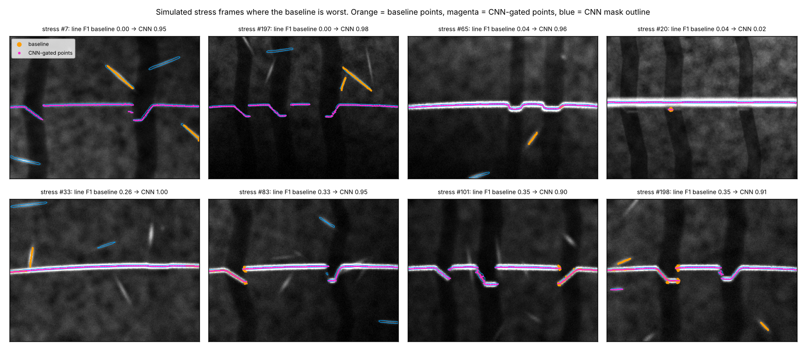
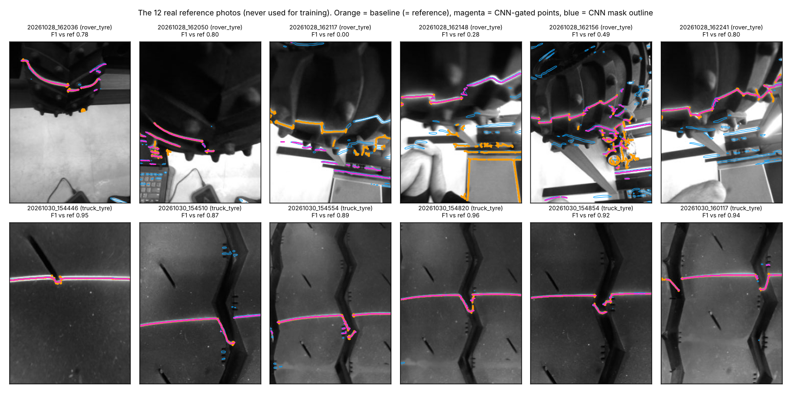
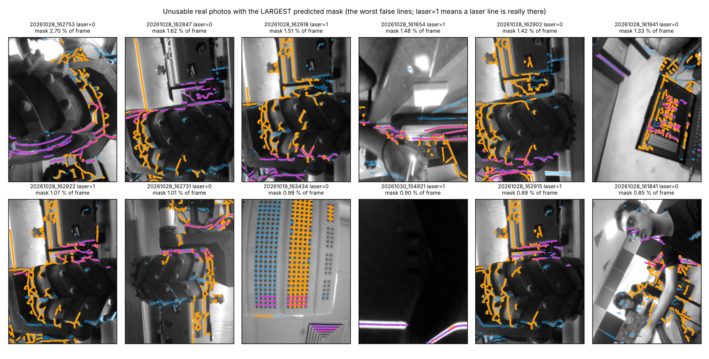

# CNN laser-line segmentation (branch `research/cnn-segmentation`)

**Question.** Can a small neural network, trained only on simulated frames, find the laser line better
than the hand-written baseline (top-hat + Steger + chain selection), especially on the `stress` set
(glints, paint, sunlight)? And does it still work on the real hand-held photos (sim-to-real)?

**Short answer.** On simulation: yes, clearly. On the real photos: partly. The truck-tyre photos work,
the cluttered rover/bench photos do not, and the network still draws "lines" on most photos that have
no laser. The network alone is also not enough: it needs a small rule-based step that keeps one line.

## 1. Method

### Network (`algos/cnn_line.py`, class `TinyUNet`)
| stage | resolution | layers (3x3 conv + BatchNorm + ReLU) | channels |
|---|---|---|---|
| e1 | 1/1 | 2 conv | 1 -> 8 -> 8 |
| e2 | 1/2 (max-pool) | 2 conv | 16 |
| e3 | 1/4 | 2 conv | 32 |
| mid | 1/8 | 2 conv (second one dilated x2) | 48 |
| d3, d2, d1 | 1/4, 1/2, 1/1 | bilinear up-sample, concatenate skip, 1 conv each | 32, 16, 8 |
| out | 1/1 | 1x1 conv, sigmoid | 1 (heat-map) |

84 705 parameters, 0.36 MB on disk as float32, about 0.6 x 10^9 multiply-adds per 320x240 frame (counted
by hand from the layer sizes). Fully convolutional: the same weights run on 320x240 and on 240x320.

```python
def forward(self, x):                               # x: (N, 1, H, W) in 0..1
    e1 = self.e1(x)
    e2 = self.e2(F.max_pool2d(e1, 2))
    e3 = self.e3(F.max_pool2d(e2, 2))
    m = self.mid(F.max_pool2d(e3, 2))
    up = lambda t: F.interpolate(t, scale_factor=2.0, mode="bilinear", align_corners=False)
    d3 = self.d3(torch.cat([up(m), e3], 1))
    d2 = self.d2(torch.cat([up(d3), e2], 1))
    d1 = self.d1(torch.cat([up(d2), e1], 1))
    return self.out(d1)                             # logits of the heat-map
```

### Target and loss (the choice, and why)
The laser line covers about 1 % of the pixels and the instrument needs sub-pixel accuracy. So the network
does **not** learn the hard mask `truth["mask"]`. It regresses a **soft Gaussian heat-map**
`exp(-d^2 / 2)`, where `d` is the distance in px from the pixel centre to the *exact* sub-pixel truth line
(`truth["u"], truth["v"]`, gaps between rays filled). Reasons:
- a hard mask is only pixel-accurate, and its width changes with line brightness; the Gaussian label is
  sub-pixel exact and always the same width, so its ridge *is* the line centre;
- no threshold choice is baked into the labels.

Loss = weighted soft-label BCE (weight `1 + 10*y`, so the few line pixels count) + 0.5 x soft Dice (which
does not care how many background pixels there are). Focal loss was not tried.

### Training recipe (`experiments/cnn-segmentation/train.py`)
- data: first 1000 frames of `train`; the last 200 frames of `train` are held out for all tuning.
  12 % of the samples are the laser-**off** frame of a scene (target empty).
- 160x160 crops, batch 6, AdamW, lr 4e-3 with 100-step warm-up and cosine decay, **1000 iterations only**
  (6000 crops; the machine was shared and gave ~0.6 iterations/s, so this is a short run, about 25 minutes
  wall-clock per model spread over 7-minute resumable chunks).
- two models:
  - `cnn_line_noaug.pt`: random crop + left-right flip only;
  - `cnn_line.pt` ("full" augmentation for sim-to-real): zoom 0.8-2.6x (thicker line, bigger grooves),
    rotation (sigma 10 deg, max 35), both flips, random shift, constant-grey borders, 1-4 bright
    distractor shapes (blurred ellipses / boxes; target erased where they are bright), bright uneven
    background, gain 0.6-2.5x, gamma 0.6-1.6, blur, noise.

### Heat-map -> sub-pixel points
Four readouts were compared (all in `algos/cnn_line.py`):
1. `column`: one-point-per-column style soft-argmax (centroid of the heat-map +-3 px around each column peak);
2. `heat`: the same, but along **rows** where the line is steep (groove walls), chosen by heat-map curvature;
3. `gated` (default): as 2, but the centroid weights are `heat x (image - local background)`, i.e. the
   network says *where*, the image intensity says *exactly where*;
4. `steger`: the baseline's Steger points on the image (relaxed thresholds), kept where the mask is on.

```python
def _peaks_1d(p, weight, mask, axis, half=3):
    """Local maxima of p along `axis` inside mask; centre = centroid of `weight` in +-half px."""
    q, wq, mq = (np.moveaxis(a, axis, 0) for a in (p, weight, mask))
    pk = np.zeros_like(mq)
    pk[1:-1] = mq[1:-1] & (q[1:-1] >= q[:-2]) & (q[1:-1] > q[2:])
    a, b = np.nonzero(pk)
    idx = np.clip(a[:, None] + np.arange(-half, half + 1)[None, :], 0, q.shape[0] - 1)
    ww = wq[idx, b[:, None]]
    pos = (ww * idx).sum(1) / np.maximum(ww.sum(1), 1e-9)      # sub-pixel centre
    return pos, b.astype(float), a, b
# "gated":  weight = p * max(gray - erode(gray, 9x9), 0)      "heat"/"column":  weight = p
```
(excerpt slightly condensed)

### The rule-based step that turned out to be necessary (`clean_mask`)
The network marks **every thin bright streak**, glints included (first attempt, held-out frames: depth
P95 = 84 mm, because one stray glint far from the line is turned into a huge "depth" by the calibration
polynomial). So after thresholding (heat > 0.35, blobs < 12 px dropped) one line is selected: the piece with
the largest heat x width is the laser; other pieces are kept only if they lie within 10 px of the straight
line through it, come within 12 px of a kept piece, or sit in a column gap of the line (a groove floor)
within 60 px. Frames with < 40 points return no line. These numbers were set on the held-out part of
`train` only.

## 2. Results (exact harness output, `results/*.json`)

| algorithm | set | line F1 | line RMSE px | depth MAE mm | P95 mm | bias mm | miss | false/frame | verdict acc | false pass |
|---|---|---|---|---|---|---|---|---|---|---|
| baseline_steger | ideal | 0.931 | 0.162 | 0.147 | 0.474 | 0.068 | 0.090 | 0.093 | 0.980 | 0.013 |
| cnn_line (aug, gated) | ideal | 0.973 | 0.140 | 0.061 | 0.173 | 0.031 | 0.019 | 0.000 | 0.987 | 0.013 |
| cnn_line_column (aug) | ideal | 0.966 | 0.164 | 0.065 | 0.164 | 0.002 | 0.019 | 0.000 | 0.987 | 0.013 |
| cnn_line_steger (aug) | ideal | 0.960 | 0.160 | 0.102 | 0.329 | 0.080 | 0.015 | 0.080 | 0.987 | 0.013 |
| cnn_line_noaug (gated) | ideal | 0.974 | 0.147 | 0.055 | 0.156 | 0.036 | 0.011 | 0.000 | 0.987 | 0.013 |
| cnn_line_noaug_column | ideal | 0.985 | 0.142 | 0.047 | 0.138 | 0.015 | 0.015 | 0.000 | 0.987 | 0.013 |
| baseline_steger | stress | 0.821 | 0.235 | 1.516 | 6.678 | 1.017 | 0.099 | 0.280 | 0.915 | 0.015 |
| cnn_line (aug, gated) | stress | 0.882 | 0.222 | 0.668 | 2.187 | 0.361 | 0.057 | 0.130 | 0.945 | 0.000 |
| cnn_line_column (aug) | stress | 0.875 | 0.224 | 0.589 | 1.444 | 0.270 | 0.066 | 0.105 | 0.925 | 0.000 |
| cnn_line_steger (aug) | stress | 0.873 | 0.231 | 0.640 | 1.494 | 0.382 | 0.054 | 0.190 | 0.940 | 0.000 |
| cnn_line_noaug (gated) | stress | 0.958 | 0.217 | 0.236 | 0.467 | 0.057 | 0.009 | 0.050 | 0.985 | 0.000 |
| cnn_line_noaug_column | stress | 0.964 | 0.209 | 0.239 | 0.464 | 0.015 | 0.009 | 0.040 | 0.985 | 0.000 |
| baseline_steger | legal | 0.977 | 0.155 | 0.053 | 0.210 | -0.000 | 0.054 | 0.127 | 0.993 | 0.000 |
| cnn_line (aug, gated) | legal | 0.993 | 0.134 | 0.036 | 0.087 | -0.031 | 0.054 | 0.000 | 0.987 | 0.007 |
| cnn_line_column (aug) | legal | 0.994 | 0.152 | 0.043 | 0.097 | -0.038 | 0.051 | 0.000 | 0.987 | 0.007 |
| cnn_line_steger (aug) | legal | 0.979 | 0.151 | 0.032 | 0.077 | -0.025 | 0.054 | 0.133 | 0.987 | 0.000 |
| cnn_line_noaug (gated) | legal | 0.990 | 0.130 | 0.035 | 0.079 | -0.018 | 0.054 | 0.000 | 0.993 | 0.000 |
| cnn_line_noaug_column | legal | 0.995 | 0.129 | 0.035 | 0.089 | -0.029 | 0.051 | 0.000 | 0.980 | 0.000 |

Oracle (true line + default depth stage) for scale: depth MAE 0.071 / 0.108 / 0.018 mm on ideal / stress / legal.

Real photos (86; no training, no tuning on them):

| algorithm | line_f1_ref (12) | depth_mae_px (6 truck) | found_ref | repeat_pair_diff_px | usable_recall | false_measure |
|---|---|---|---|---|---|---|
| baseline_steger | 1.000 (by construction) | 0.132 | 6/6 | 2.450 | 0.947 | 0.701 |
| cnn_line (aug, gated) | 0.722 | 1.079 | 6/6 | 2.470 | 0.895 | 0.493 |
| cnn_line_column (aug) | 0.708 | 1.091 | 6/6 | 2.330 | 0.895 | 0.493 |
| cnn_line_steger (aug) | 0.742 | 0.859 | 6/6 | 2.360 | 0.842 | 0.418 |
| cnn_line_noaug (gated) | 0.643 | 7.154 | 6/6 | 4.030 | 0.895 | 0.433 |
| cnn_line_noaug_column | 0.641 | 8.025 | 6/6 | 4.880 | 0.895 | 0.433 |

Runtime. The harness `ms_per_frame` values in the JSON files were taken while other jobs used the same
two cores and vary by 4x for the same code (50 to 198 ms), so do not compare them. Measured back-to-back
in one process (best of 3, 25 ideal frames, one thread, machine still loaded): baseline 19 ms, CNN forward
pass 75 ms, CNN + `gated` readout 90 ms, CNN + `steger` readout 126 ms. So the CNN is about **4-5x slower**
than the baseline on a laptop CPU.

Readout comparison on the 200 held-out `train` frames (aug weights / no-aug weights): line RMSE
gated 0.190 / 0.188, heat 0.205 / 0.194, column 0.201 / 0.180, steger 0.203 / 0.219 px; baseline 0.204 px.

## 3. Findings

**Simulation.**
- Both CNN models beat the baseline on every simulated set in line F1 and depth error. On `ideal` the
  depth MAE drops from 0.147 to about 0.05-0.06 mm, which is at the oracle level (0.071); line RMSE
  improves slightly (0.162 -> 0.140-0.147 px). There is no accuracy cost on `ideal`/`legal`; the only
  blemish is one extra unsafe verdict on `legal` for the augmented model (false pass 0.007 = 1 frame).
- On `stress` the no-augmentation model cuts depth MAE from 1.516 to 0.236 mm and P95 from 6.68 to 0.47 mm;
  misses fall from 9.9 % to 0.9 %. The augmented model only gets to 0.668 mm (P95 2.19 mm).
- Sub-pixel readout: differences are small. Weighting by image intensity (`gated`) or plain heat-map
  centroid both reach the baseline's accuracy or better; gating the baseline's Steger points was the
  **worst** option here (extra ridge points inside the mask give false grooves: 0.08-0.19 false/frame).
- Figure: `figs/cnn-segmentation/sim_stress.png` (the 8 stress frames where the baseline is worst).
  Frame #20 is a failure of both: a paint stripe lies 3-15 px from a very dim laser (41 DN) and both
  methods follow the paint.



**Why augmentation hurts on simulation (important caveat).** In the simulator the laser is always a
roughly horizontal streak in the middle of the frame and glints have random angles. The no-aug network
can use "horizontal = laser". Rotation/zoom augmentation removes exactly that cue, and then a glint and a
piece of laser line look the same inside the network's ~60 px field of view. So part of the `stress` gain
of the no-aug model comes from a prior of the simulator. For the real product this prior is *legitimate*
(the holder fixes the line), for hand-held photos it is not.

**Sim-to-real.**
- Truck-tyre photos (6 reference frames): augmented model F1 vs reference 0.87-0.96, depth found on 6/6,
  depth_mae_px 1.08 (baseline-vs-itself: 0.13). Without augmentation the line is found but the depth is
  wrong by 7.2 px on average: augmentation is clearly needed for sim-to-real (7.15 -> 1.08 px).
- Rover-tyre photos (6 reference frames, bright cluttered background): F1 between 0.00 and 0.80. The
  network marks table edges and floor stripes, and the "largest piece is the laser" rule then picks the
  wrong one (photo 162117: F1 0.00). Note the reference itself contains background edges on these frames
  (see section 5).
- 67 unusable frames: `false_measure` 0.493 (33 of 67 frames get a depth; baseline 0.701 = 47 of 67).
  Split by label: of the 55 frames with **no laser at all** the CNN still reports a groove on 25 (baseline
  38); of the 12 unusable frames where a laser line *is* visible, 8 (baseline 9). Mean predicted-mask area
  on the 67 frames: 0.419 % of the frame (0.370 % on the 55 no-laser frames) versus 1.099 % on the 19
  usable frames; 43 of 67 frames produce line points at all. The no-aug model: 0.260 % mask area,
  false_measure 0.433.
  So the network is **not** a usable/unusable detector: mask area on junk frames is only ~2.6x smaller than
  on good frames, and it happily traces window edges, breadboard rows and wheel rims.
- usable_recall 0.895 (17 of 19; baseline 0.947).




## 4. Could it run on the camera board (OpenMV H7 Plus, STM32H743, 32 MB SDRAM)?
Not measured: this is an estimate.
- Memory is fine: 85 k weights = 85 kB as int8; the largest activations (full-resolution, 8+16 channels at
  the last concatenation) are about 2-3 MB as int8.
- Speed is the problem: ~0.6 x 10^9 multiply-adds per frame. A Cortex-M7 at 480 MHz with CMSIS-NN int8
  does on the order of 10^8 multiply-adds per second, so expect **several seconds per frame**, plus the
  readout. The baseline costs 19 ms on a laptop core.
- Bilinear up-sampling and the dilated conv are supported by TFLite-Micro but the model would have to be
  re-exported and quantised, and sub-pixel accuracy after int8 quantisation is untested.
Conclusion: as built, laptop/phone/cloud side only. A board version would need roughly a 10x cut
(stride-2 stem, half-resolution heat-map, fewer channels) and would lose sub-pixel accuracy unless the
`gated` readout on the full-resolution image makes up for it. Untested.

## 5. Things in the harness / simulator that may mislead
1. **`false_measure` cannot reach 0 for a pure line extractor.** 12 of the 67 "unusable" frames have a
   visible laser line (`laser=1, usable=0`); finding it is correct behaviour for `extract_line`. Baseline
   reports a depth on 9/12 of these, the CNN on 8/12.
2. **`line_f1_ref` on rover frames rewards copying the baseline's mistakes.** The reference *is* the
   baseline output, and on frames 162117, 162148, 162156 it visibly includes non-laser edges (the outline
   of a floor mat, table edges; orange points in `real_refs.png`). The truck-tyre references look clean.
3. **The default depth stage has no plausibility limit.** A handful of stray points far from the line
   become 30-160 mm "grooves" through the calibration polynomial (held-out frames before line selection:
   depth P95 = 84 mm with only 2 % misses). A cap at ~20 mm, or ignoring points far from the surface fit,
   would make the depth metrics less sensitive to single outliers for every algorithm.
4. **The simulator's laser line always sits at the same place and angle**, on a 320x240 landscape frame,
   with grooves <= ~36 px deep and no "hook". A learned method can exploit this (see caveat above), so
   `stress` flatters learned methods compared with what hand-held real photos show.
5. **`ms_per_frame` is wall-clock on a shared machine** (same code: 50-198 ms). Use relative timings.

## 6. Limitations / honesty
- Very short training (1000 iterations, one seed, one architecture). No hyper-parameter search. Results
  may move by a few hundredths with another seed; this was not measured.
- Thresholds and the line-selection rule were tuned on the held-out 200 `train` frames. Nothing was
  trained or tuned on `ideal`/`stress`/`legal` or on the real photos. The decision to present the
  augmented model as `cnn_line` (default) was made before scoring; both models are reported in full.
- The line-selection rule is hand-written again. "CNN beats rules" is really "CNN detector + small rule
  beats Steger detector + similar rule".
- No learned usable/unusable output; `usable` is left to the harness default.

## 7. Recommendation
- For the **holder-mounted product with processing on a laptop/phone/cloud**, the CNN is worth it: 6x lower
  depth error on `stress`, no loss on `ideal`/`legal`, 90 ms per frame. Train it for the fixed-holder
  geometry (little rotation augmentation) but with photometric augmentation.
- For **on-board processing (STM32H7)** keep the classical baseline; the CNN is far too slow there (estimated seconds per frame).
- It does **not** solve "is this frame usable": that needs a separate gate.
- Next steps if continued: longer training with more seeds; add real no-laser photos as negatives
  (cheap to collect, no labels needed); add a per-frame "laser present" output; check on real
  holder-mounted frames once they exist.
