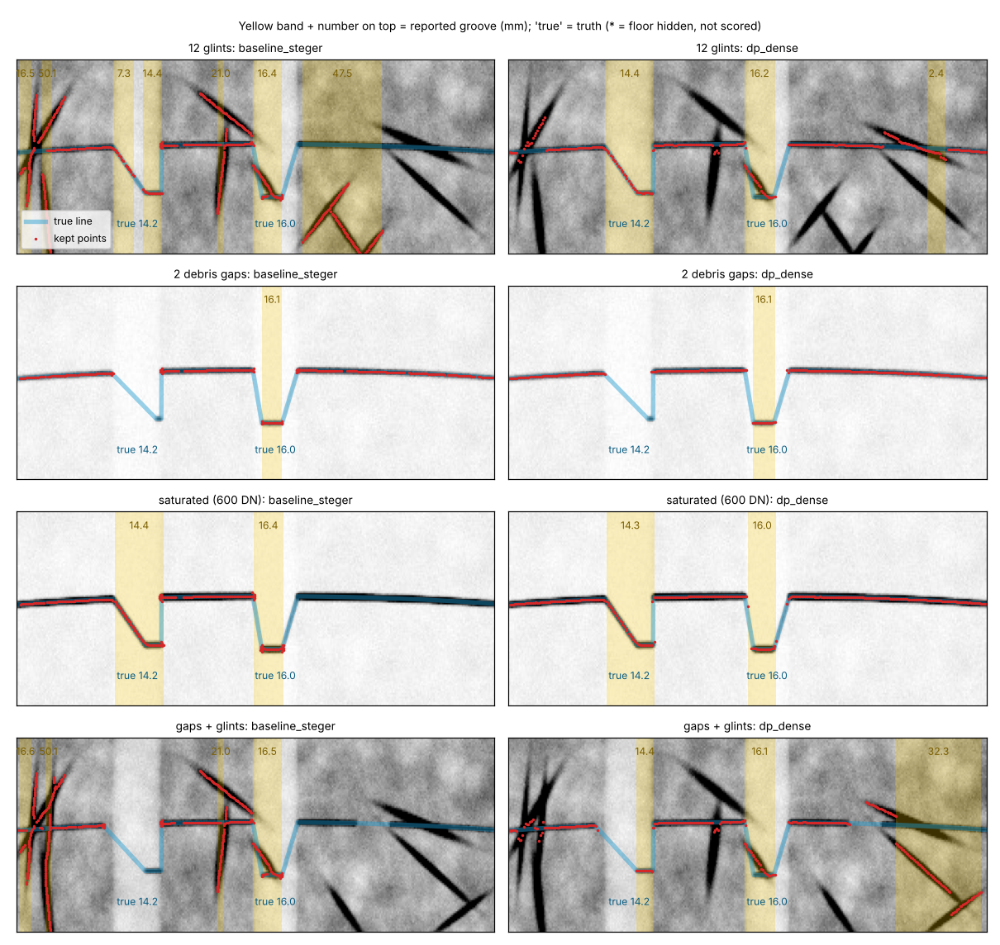
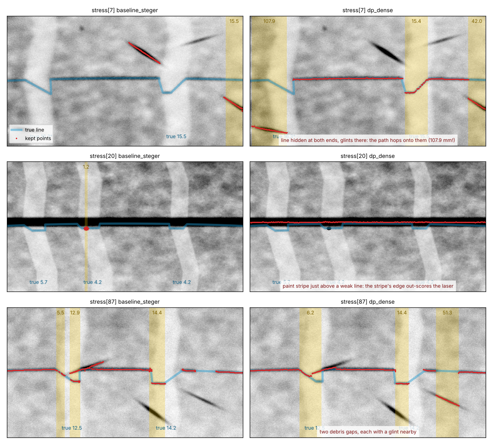
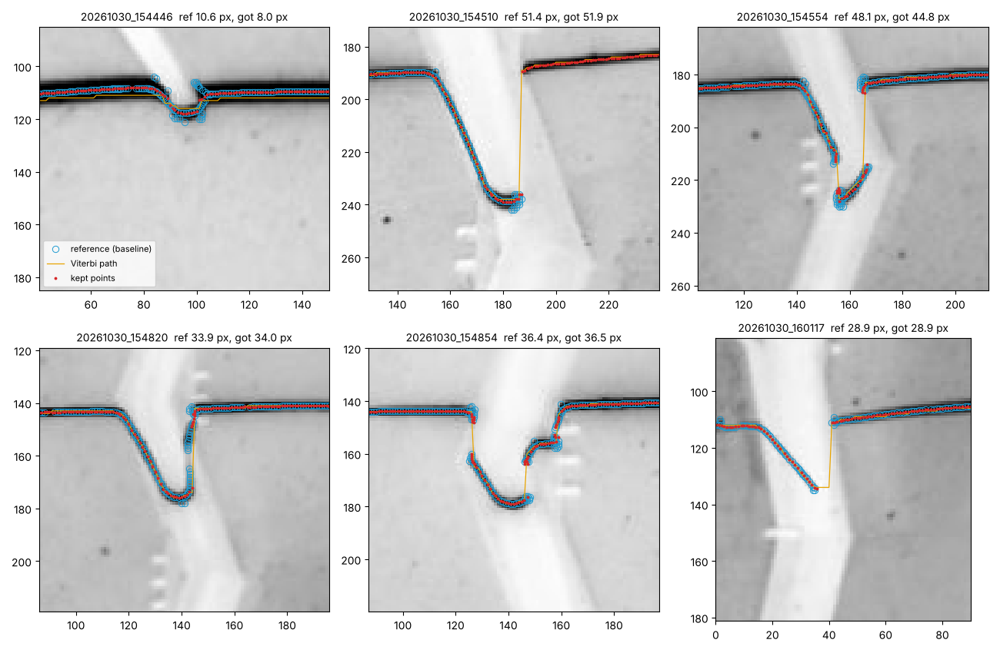
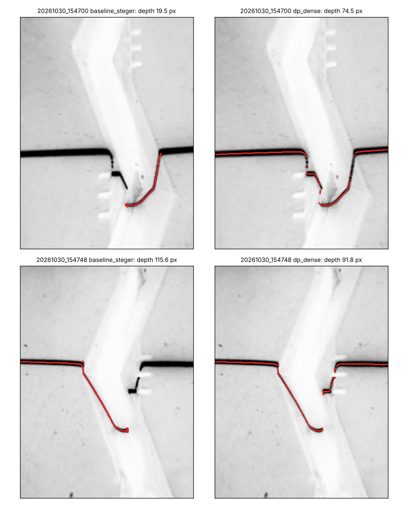

# Globally optimal line tracking (branch `research/dp-tracking`)

**Question.** The baseline finds Steger ridge points and then *greedily* keeps "the strongest chain and
nearby pieces". Does choosing the line *globally* (dynamic programming) lose fewer line pieces, miss
fewer grooves and report fewer false ones?

**Short answer.** Yes, clearly, on every simulated set, at about 1.4x the baseline's runtime.
`dp_dense` is the one to keep. Two things did as much as the DP itself and are worth taking even
without it: (1) one point per column instead of Steger's "offset within +-0.5 px" test, and (2) locating
a saturated line by the midpoint of its two half-maximum edges.

## What was built

| module | idea | lines |
|---|---|---|
| `algos/dp_dense.py` | Viterbi over **every row** of every column. Rows without ridge have reward 0, so "no line here" is not a separate state: the path just carries on at the same height through a gap | 176 |
| `algos/dp_dense_rt.py` | the same + a "run test" that drops short, isolated, tilted runs (glints) | 12 |
| `algos/dp_smooth.py` | the same + edge-preserving smoother (the least-squares form of a Kalman/RTS smoother) | 38 |
| `algos/dp_cand.py` | textbook version: 5 candidate peaks per column + one gap state | 66 |
| `algos/dp_graph.py` | shortest path on the pixel grid with `skimage.graph.MCP_Geometric` | 35 |

All use only the laser-on frame and the shared depth stage (`bench/depth.py`).

**Candidates.** I use neither column maxima nor the baseline's Steger points as candidates. The
unary term is the dense Steger ridge strength (top-hat 15 px, Gaussian 1.5 px, most negative Hessian
eigenvalue), divided by the median over columns of the column maximum (the laser crosses most
columns, so this is "typical laser strength") and **capped at 1**. The cap is what makes glints
harmless where the laser is visible: a glint brighter than the laser earns nothing extra, so leaving
the line for it only costs. The contrast threshold could drop from 35 to 12 grey levels because the
path, not the threshold, rejects clutter (this is why a 30 DN laser still works, see the factor table).

**Cost function and recursion** (`dp_dense.viterbi`; `A=0.15, s=3, J=1.0, B=0.06`, tuned on `train[:200]`):

```python
# pen(d) = A*|d|       for |d| <= s   (gentle slope, e.g. a lit wall: cheap)
#        = J + B*|d|   otherwise      (a groove edge: fixed price + a little per px)
for c in range(1, W):
    full = C[c - 1]                                   # C[c, v] = cost of the best path ending at (c, v)
    prev = full[s:s + H]
    near = prev.copy()
    for k in range(1, s + 1):                         # smooth move of k rows up or down: A per px
        np.minimum(near, full[s - k:s - k + H] + A * k, out=near)
        np.minimum(near, full[s + k:s + k + H] + A * k, out=near)
    # jump from any row v': prev[v'] + J + B*|v - v'|, as two running minima (from above, from below)
    far = J + np.minimum(acc(prev - Br) + Br, acc((prev + Br)[::-1])[::-1] - Br)
    C[c, s:s + H] = np.minimum(near, far) - R[c]      # R = reward in 0..1
```

The two running minima make the jump term exact in O(H) per column (no window, no maximum jump).
Back-pointers are not stored; the walk back recomputes one `argmin` per column.

**From path to points** (`points_near_path`): one sub-pixel point per path column (strongest of the
3 rows around the path + its Steger offset), except where the bright band is wider than 5 px; there
the point is the midpoint of the band's two half-maximum edges:

```python
def edge(S):                                   # S[:, 0] = the path pixel, going outwards
    n = np.minimum.accumulate(S >= lvl, axis=1).sum(axis=1)          # pixels above half-max, contiguous
    n = np.clip(n, 1, S.shape[1] - 1)
    i = np.arange(len(S))
    a, b = S[i, n - 1], S[i, n]                # last pixel above, first below
    return n - 1 + np.clip((a - lvl[:, 0]) / np.maximum(a - b, 1e-6), 0, 1)
down, up = edge(T[:, half:]), edge(T[:, half::-1])
return r + (down - up) / 2, down + up          # centre, width
```

**Walls and hooks.** The path is single-valued: one row per column.
- A lit, slanted wall (simulator: up to ~3 px per column) is simply followed (the cheap `A` moves).
- Where the path jumps between neighbouring columns, the Steger points lying between the two ends
  are added back ("wall fill"), so a near-vertical lit wall is kept.
- A hook (real photos: the line turns back under itself) is **not** representable. The path takes
  one branch. Measured cost: on photo 154554 the depth reads 44.8 px against a reference of 48.1 px
  (the lowest tip of the hook is on the other branch). `dp_graph` can in principle walk backwards
  along a hook, but it was worse everywhere else.

## Results (exact harness output, `results/*.json`)

| algorithm | set | line F1 | RMSE px | depth MAE mm | P95 mm | bias mm | miss | false/frame | verdict acc | false pass |
|---|---|---|---|---|---|---|---|---|---|---|
| baseline_steger | ideal | 0.931 | 0.162 | 0.147 | 0.474 | +0.068 | 0.090 | 0.093 | 0.980 | 0.013 |
| **dp_dense** | ideal | 0.978 | 0.123 | 0.064 | 0.186 | +0.034 | 0.015 | 0.013 | 0.987 | 0.013 |
| dp_dense_rt | ideal | 0.978 | 0.123 | 0.064 | 0.186 | +0.034 | 0.015 | 0.013 | 0.987 | 0.013 |
| dp_smooth | ideal | 0.977 | 0.133 | 0.070 | 0.216 | +0.032 | 0.015 | 0.013 | 0.987 | 0.013 |
| dp_cand | ideal | 0.980 | 0.121 | 0.067 | 0.196 | +0.029 | 0.015 | 0.007 | 0.987 | 0.013 |
| dp_graph | ideal | 0.946 | 0.133 | 0.058 | 0.166 | +0.030 | 0.015 | 0.027 | 0.987 | 0.013 |
| oracle_line | ideal | 0.998 | 0.000 | 0.071 | 0.205 | +0.068 | 0.011 | 0.000 | 0.987 | 0.013 |
| baseline_steger | stress | 0.821 | 0.235 | 1.516 | 6.678 | +1.017 | 0.099 | 0.280 | 0.915 | 0.015 |
| **dp_dense** | stress | 0.944 | 0.215 | 0.544 | 0.591 | +0.266 | 0.018 | 0.125 | 0.955 | 0.000 |
| dp_dense_rt | stress | 0.945 | 0.215 | 0.544 | 0.591 | +0.266 | 0.018 | 0.110 | 0.955 | 0.000 |
| dp_smooth | stress | 0.944 | 0.198 | 0.546 | 0.613 | +0.257 | 0.021 | 0.125 | 0.950 | 0.000 |
| dp_cand | stress | 0.938 | 0.213 | 3.850 | 7.587 | +3.490 | 0.021 | 0.180 | 0.945 | 0.005 |
| dp_graph | stress | 0.779 | 0.233 | 0.677 | 2.841 | -0.050 | 0.107 | 0.285 | 0.955 | 0.000 |
| oracle_line | stress | 0.998 | 0.000 | 0.108 | 0.344 | +0.069 | 0.006 | 0.005 | 1.000 | 0.000 |
| baseline_steger | legal | 0.977 | 0.155 | 0.053 | 0.210 | -0.000 | 0.054 | 0.127 | 0.993 | 0.000 |
| **dp_dense** | legal | 0.995 | 0.133 | 0.032 | 0.072 | -0.023 | 0.051 | 0.000 | 0.993 | 0.000 |
| dp_dense_rt | legal | 0.995 | 0.133 | 0.032 | 0.072 | -0.023 | 0.051 | 0.000 | 0.993 | 0.000 |
| dp_smooth | legal | 0.994 | 0.143 | 0.032 | 0.073 | -0.023 | 0.051 | 0.000 | 0.987 | 0.007 |
| dp_cand | legal | 0.994 | 0.135 | 0.031 | 0.072 | -0.023 | 0.051 | 0.000 | 0.993 | 0.000 |
| dp_graph | legal | 0.972 | 0.138 | 0.033 | 0.076 | -0.024 | 0.054 | 0.120 | 0.987 | 0.007 |
| oracle_line | legal | 1.000 | 0.000 | 0.018 | 0.038 | +0.002 | 0.044 | 0.000 | 1.000 | 0.000 |

Real photos (86 frames, 12 references, 6 with a depth):

| algorithm | line_f1_ref | depth_mae_px | found_ref | repeat pair diff px | usable_recall | false_measure |
|---|---|---|---|---|---|---|
| baseline_steger (reference by construction) | 1.000 | 0.132 | 6/6 | 2.45 | 0.947 | 0.701 |
| **dp_dense** | 0.755 | 1.127 | 6/6 | 2.45 | 0.842 | 0.597 |
| dp_dense_rt | 0.740 | 4.338 | 6/6 | 2.45 | 0.895 | 0.567 |
| dp_smooth | 0.755 | 1.158 | 6/6 | 2.60 | 0.895 | 0.597 |
| dp_cand | 0.746 | 1.152 | 6/6 | 2.43 | 0.947 | 0.642 |
| dp_graph | 0.678 | 0.799 | 5/6 | 2.44 | 0.737 | 0.761 |

`dp_dense` depth on the 6 truck-tyre frames, px (reference -> dp_dense): 10.63 -> 7.97, 51.38 -> 51.90,
48.14 -> 44.79, 33.94 -> 34.02, 36.40 -> 36.47, 28.87 -> 28.95. Four agree within 0.52 px; the two
others are explained below.

**Runtime.** The `ms_per_frame` in the JSON files is not usable for comparison: the machine was
shared (load average 8-12 on 2 cores) and my re-run of the unchanged baseline printed 88-117 ms
against the 22-25 ms in the committed `baseline_steger.json`. `experiments/dp-tracking/timing.py`
lets the algorithms take turns on the same 40 train frames and reports the best of 5 rounds:

| baseline_steger | dp_dense | dp_dense_rt | dp_smooth | dp_cand | dp_graph |
|---|---|---|---|---|---|
| 19.5 ms | 27.7 ms (x1.42) | 27.0 (x1.39) | 29.0 (x1.49) | 30.8 (x1.58) | 60.2 (x3.09) |

About half of `dp_dense`'s time is the 320-iteration Python loop; the recursion itself is
O(W*H) additions (77 000 states), which is small in C.

## Findings

1. **Global tracking reduces misses and false grooves** (measured). Stress: miss 0.099 -> 0.018,
   false/frame 0.280 -> 0.125, depth P95 6.68 -> 0.59 mm, line F1 0.821 -> 0.944. Ideal: miss
   0.090 -> 0.015, false 0.093 -> 0.013. Legal: false 0.127 -> 0.000, miss 0.054 -> 0.051 (the
   oracle misses 0.044 there: the rest are grooves shallower than the depth stage's 0.5 mm floor).
   Line RMSE did not get worse: 0.162 -> 0.123 px (ideal), 0.235 -> 0.215 (stress).
2. **The baseline's false grooves on clean frames are not phantoms** (measured,
   `harness_checks.txt`). All 14 (ideal) and all 19 (legal) overlap a true groove: the groove is
   reported twice because the line has a hole in it and the depth stage splits a run at a 5 px hole.
   Likely cause (inferred, not isolated): Steger's test "sub-pixel offset within +-0.5 px in both axes"
   fails for *both* neighbouring pixels when the line centre sits half-way between two rows; with my
   re-implementation of the same test 10.4 % of line columns on `ideal[:60]` have no passing pixel.
   Taking one point per path column removes the problem (train: F1 0.892 -> 0.928, false 0.225 -> 0.100
   from this change alone).
3. **Saturated lines** (measured on train). A saturated or defocused line is a flat band; at
   sigma 1.5 the ridges are its two edges, ~3 px from the centre, so line F1 fell to 0.25-0.5 on such
   frames. The half-maximum midpoint fixed it: train F1 0.933 -> 0.959, RMSE 0.198 -> 0.178, depth
   P95 1.0 -> 0.47 mm. An earlier attempt (pick a larger sigma per frame from the measured line width)
   failed: a paint stripe set the width and the tracker then followed the stripe.
4. **A dense state space beats candidates + gap state** (measured). `dp_cand` equals `dp_dense` on
   clean frames but on stress its depth MAE is 3.85 mm against 0.54: its gap state has no height, so
   "leave the line, come back anywhere" costs the same whatever the distance, and glints far from
   the line get picked up through gaps. Using the same penalty for all rows needs no more code.
5. **Smoothing does not pay** (measured, `edges.txt`, 150 train frames). Edge-preserving smoothing
   (`lam=4`, breaks at steps > 1 px) lowers the error on flat stretches by 5 % (0.246 -> 0.233 px)
   and leaves edges alone (0.599 -> 0.607), with no measurable change in depth MAE; on the test sets
   line RMSE got *worse* on ideal (0.123 -> 0.133) and legal (0.133 -> 0.143), better only on stress
   (0.215 -> 0.198). A plain smoother without breaks smears edges: edge RMSE 0.599 -> 0.730 px and
   depth P95 0.72 -> 0.85 mm at `lam=4`, 1.93 mm at `lam=64`. The points are already averaged along
   the line by the 2-D Gaussian (sigma 1.5 px), so there is little independent noise left to remove.
6. **The run test is a simulator-only gain** (measured). Dropping short isolated tilted runs removes
   some glint pick-ups (stress false 0.125 -> 0.110) but deletes the hook bottom on real photo 154554
   (25.5 px against 48.1; real `depth_mae_px` 1.13 -> 4.34). In the simulator groove floors are flat
   and parallel to the surface; in the real photos they are not. Not recommended.
7. **Orientation weighting failed** (measured on train): multiplying the reward by |normal_v|^2 to
   down-weight steep streaks raised misses 0.037 -> 0.063. Dropped.
8. **Shortest path with a library** (`dp_graph`) is the shortest file but the worst tracker (stress
   F1 0.779, false 0.285) and 3x slower: with a single per-pixel cost there is no way to make a
   smooth move cheap and a jump expensive separately.

## Which stress factors still break it

Same 40 clean scenes re-rendered with one factor each (`experiments/dp-tracking/stress_factors.py`,
scored with the harness's `eval_sim`; extra data, not a test set):

| factor | baseline F1 / MAE mm / miss / false | dp_dense F1 / MAE mm / miss / false |
|---|---|---|
| clean | 0.927 / 0.328 / 0.092 / 0.075 | 0.975 / 0.044 / 0.026 / 0.025 |
| 12 glints | 0.598 / 16.644 / 0.092 / 1.825 | 0.805 / 3.958 / 0.079 / 0.675 |
| paint stripe | 0.888 / 0.495 / 0.158 / 0.100 | 0.890 / 0.242 / 0.026 / 0.175 |
| 2 debris gaps | 0.903 / 0.286 / 0.147 / 0.075 | 0.973 / 0.049 / 0.059 / 0.025 |
| gaps + 12 glints | 0.557 / 17.579 / 0.145 / 1.400 | 0.747 / 6.002 / 0.174 / 0.750 |
| dim laser (30 DN) | 0.669 / 0.038 / 0.500 / 0.025 | 0.951 / 0.087 / 0.026 / 0.025 |
| saturated (600 DN) | 0.916 / 0.535 / 0.079 / 0.075 | 0.981 / 0.047 / 0.026 / 0.000 |
| strong blur | 0.933 / 0.540 / 0.053 / 0.050 | 0.961 / 0.069 / 0.013 / 0.000 |

Solved: debris gaps, dim laser, saturation, blur. **Not solved: many bright glints** (0.675 false
grooves per frame, MAE 4 mm) and a **paint stripe** (more false grooves than the baseline: 0.175
against 0.100). The mechanism is always the same: a glint or stripe edge is only attractive where
the laser itself is missing (debris gap, hidden groove floor, frame edge) or weak; there the path
has nothing to lose and a capped reward of 1 per column to gain.



*One scene, four factors, baseline (left) and dp_dense (right). Rows 1 and 4 show both the gain
(no glint chains) and the remaining failure (right-hand glint taken where the line is hidden).*



*Three `stress` test frames where dp_dense is wrong (chosen after scoring, for analysis only).
stress[7]: the laser is hidden at both ends and the path hops onto glints, one of them 108 mm
"deep". stress[20]: a paint stripe just above a weak line; the stripe's edge beats the laser for the
whole frame (3 grooves missed). stress[87]: two debris gaps, a glint under one of them.*

Of dp_dense's 25 false grooves on stress, 23 are such phantoms and 2 are duplicates.

## Real photos

- **Truck-tyre frames with a reference (6):** all 6 get a depth. Four agree within 0.52 px.
  154554 reads 44.8 px against 48.1 (the hook, see above). 154446 reads 8.0 against 10.6: there the line is
  a saturated band about 8 px wide and the difference is within its half-width; I cannot say which
  number is right. Line agreement on these 6 frames is F1 0.86-0.97 (`harness_checks.txt`).
- **Rover-tyre frames with a reference (6):** F1 0.35-0.81, and that is what pulls `line_f1_ref`
  down to 0.755. On these frames the reference has up to 752 points in a 240 px wide image; it
  includes a laptop keyboard, a box outline and bench edges that the baseline kept. The single-valued
  path cannot follow them and should not.
- **Truck-tyre frames without a reference:** on 154700 and 154748 the line is saturated and the
  baseline loses half of it (figure below); dp_dense tracks the whole groove and reads 74.5 px
  and 91.8 px where the baseline reads 19.5 px and 115.6 px. Judged by eye only; no reference exists.



*The 6 reference frames, zoomed. Blue circles: reference (baseline). Orange: Viterbi path. Red: kept points.*



*Two saturated truck-tyre photos without a reference: baseline (left), dp_dense (right).*

## Things in the harness / simulator to be aware of

1. `ms_per_frame` is wall-clock on a shared machine (baseline: 22-25 ms committed, 88-117 ms when I
   re-ran it with identical accuracy numbers). Do not compare it across branches.
2. `usable_recall` counts a frame as "usable" as soon as any groove is reported, right or wrong.
   dp_dense loses two "hits" against the baseline: 162216 (rover tyre; the baseline's grooves are 101
   and 115 px "deep") and 154337 (the baseline reports 33.9 px on a frame where I see no groove
   crossing). The metric rewards reporting anything.
3. `found_ref` does not check the value: `dp_dense_rt` scores 6/6 while reading 25.5 px for 48.1.
4. The rover-tyre references contain background clutter (above). `line_f1_ref` on all 12 mixes "agrees
   on the laser" with "reproduces the baseline's clutter"; the 6 truck frames alone are more meaningful.
5. `line_f1` recall includes truth samples that are too dim to see: on average 4.3 % of the scored
   truth samples on `ideal` (max 14.8 % in one frame) lie where the clean line image is below 25 % of
   the line peak. An image-based method cannot reach the oracle's 0.998.
6. The depth stage has no plausibility limit (a 107.9 mm "groove" is accepted) and splits a groove
   at any 5 px hole in the line. Both inflate `false_per_frame` and the depth MAE for every extractor.
7. The simulator has no hook: floors are flat and parallel to the surface. Any rule that uses this
   (my run test) looks good in simulation and fails on the real photos.

## Limitations

- One row per column: a hook loses its lower branch (3.3 px, 7 %, on the one frame where it mattered).
- Assumes the line runs roughly left-right and crosses most columns (the reward scale is the median
  column maximum). The lugged rover tyre, where the line breaks into separate steps, is outside it.
- Glints and paint where the laser is hidden are not solved; no confidence output is produced.
  A laser-off frame or a "is this frame usable" gate would address it better than more path rules.
- Parameters were tuned on `train[:200]` only, by hand over small grids; `ideal/stress/legal` were
  used for the final scores and for picking failure pictures after scoring. The run test was switched
  off because of real photo 154554 (a real test label): that is the one decision informed by test data.
- Real-photo conclusions rest on 6 reference depths and two frames judged by eye.

## Reproduce

```
cd research && export OMP_NUM_THREADS=1
python -m bench.run algos.dp_dense --out results/dp_dense.json      # likewise dp_dense_rt, dp_smooth, dp_cand, dp_graph
PYTHONPATH=. python experiments/dp-tracking/timing.py
PYTHONPATH=. python experiments/dp-tracking/stress_factors.py render /tmp/f.pkl
PYTHONPATH=. python experiments/dp-tracking/stress_factors.py score /tmp/f.pkl algos.baseline_steger algos.dp_dense
PYTHONPATH=. python experiments/dp-tracking/edges.py 150
PYTHONPATH=. python experiments/dp-tracking/harness_checks.py
PYTHONPATH=. python experiments/dp-tracking/figs.py /tmp/f.pkl
```
