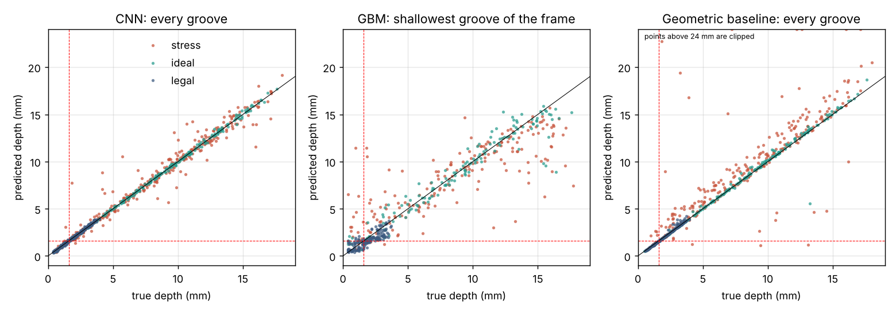
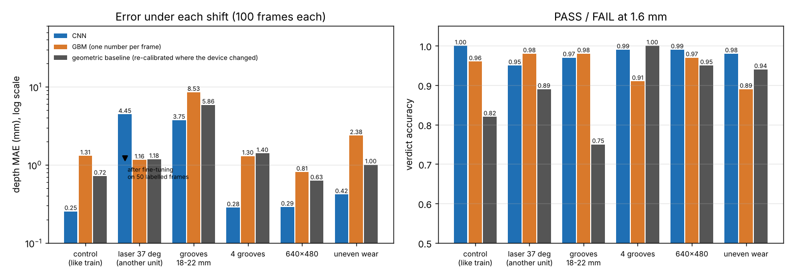
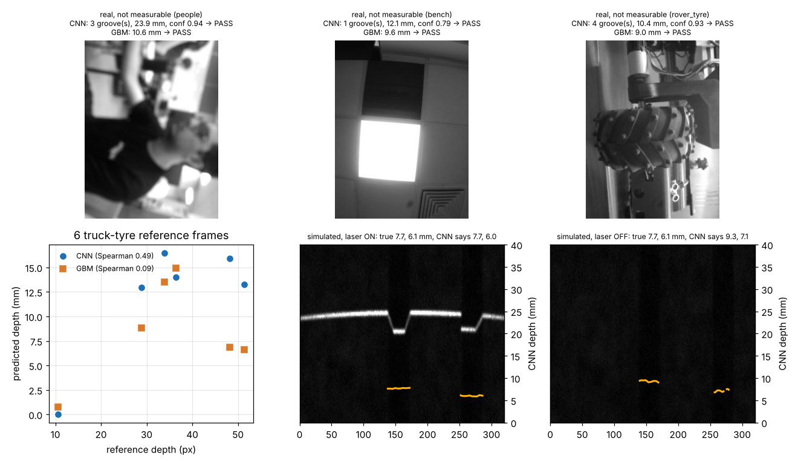

# end-to-end: why not just learn depth directly?

Branch `research/end-to-end`. Question from the team: could a neural network replace the geometric
pipeline (line extraction -> shim calibration -> groove depth)? Two learners were trained **only on
the simulated `train` set** (frames 0-999 for fitting, 1000-1199 for validation and all choices) and
scored with the shared harness. Nothing was trained or tuned on `ideal`, `stress`, `legal` or real photos.

**Short answer.** Inside the simulator a 155k-parameter CNN is *better* than the 12 Nov geometric
baseline (that was not expected). But it is not measuring in the way the instrument is supposed to:
it reports grooves and depths with the laser switched off, it reports "13 mm, PASS" for photos of people
and ceilings, it breaks when the laser angle changes by 2 degrees and needs ~50 depth-labelled tyre
frames (not a flat plate and shims) to recover, and it cannot read a depth it never saw in training.
Recommendation at the end: keep geometry as the measurement; use learning only as a helper.

## The two learners

| | `algos/e2e_cnn.py` | `algos/e2e_gbm.py` |
|---|---|---|
| input | 112-row band (rows 80-191) of the 320x240 frame; other sizes are resized first | per-column line position: blur, subtract background, brightest row + centroid (no chain selection, no outlier rejection) |
| model | 4 conv layers, rows stacked into channels, 3 1-D convs along the tread; 154,678 parameters, 615 kB | scikit-learn `HistGradientBoostingRegressor` (400 trees, absolute-error loss) on 168 features; 440 kB |
| output | per image column: groove probability + groove depth (mm). Grooves = runs with p > 0.5, depth = median over the run | one number: depth of the shallowest groove in view |
| training | 40 epochs, about 11 min on one CPU thread, flip + brightness augmentation | a few seconds |
| calibration used | none | none |

Why the per-column target for the CNN: it gives position *and* depth of every groove, so the harness can
score it like any other algorithm, and it was easy to train (validation depth error 0.32 mm per column).
A "minimum depth + number of grooves" head would have been simpler but can only be scored on the verdict.

Why the GBM predicts only the minimum: a tree model on a fixed-length vector has no natural way to
output a variable number of grooves. `measure()` therefore returns one "groove" spanning the whole
width. **Interaction with the harness:** that one groove is matched to the first true groove; every
other true groove counts as missed (miss_rate ~0.5 by construction), and its "depth MAE" compares the
predicted minimum with whichever groove came first. For the GBM read `verdict_acc`, `false_pass_rate`
and the "min-depth" columns below, not miss_rate.

Feature choice for the GBM (validation split of `train`, `experiments/end-to-end/train_gbm.py`):

| features -> model | val MAE mm | val verdict acc |
|---|---|---|
| quantiles of v(u) -> HGB | 1.276 | 0.945 |
| 64-bin profile + quantiles -> HGB | 1.324 | 0.945 |
| profile + quantiles + deepest points ("full") -> HGB (**kept**) | 1.269 | 0.950 |
| "full" -> MLP (64, 32) | 2.480 | 0.935 |
| "full" computed from the simulator's **true** line -> HGB | 0.586 | 0.990 |

The last row is the interesting one: even with a perfect line, 1000 examples are not enough for a
generic regressor to learn "subtract the surface from the floor" to better than 0.6 mm. The geometric
depth stage does it to 0.02-0.11 mm (oracle) with zero training examples.

## Results in distribution (harness numbers, `results/e2e_cnn.json`, `results/e2e_gbm.json`)

| algorithm | set | depth MAE mm | P95 mm | bias mm | miss | false/frame | verdict acc | false pass | ms/frame |
|---|---|---|---|---|---|---|---|---|---|
| e2e_cnn | ideal | 0.100 | 0.277 | 0.034 | 0.000 | 0.000 | 1.000 | 0.000 | 7.390 |
| e2e_cnn | stress | 0.483 | 1.963 | 0.096 | 0.006 | 0.020 | 0.980 | 0.015 | 5.298 |
| e2e_cnn | legal | 0.072 | 0.187 | 0.016 | 0.003 | 0.000 | 0.967 | 0.027 | 4.625 |
| e2e_gbm (one number per frame) | ideal | 0.652 | 1.672 | -0.277 | 0.493 | 0.000 | 0.973 | 0.020 | 29.697 |
| e2e_gbm | stress | 1.500 | 4.498 | 0.002 | 0.513 | 0.000 | 0.915 | 0.070 | 11.585 |
| e2e_gbm | legal | 0.536 | 1.217 | -0.379 | 0.493 | 0.000 | 0.847 | 0.047 | 10.095 |
| baseline_steger | ideal | 0.147 | 0.474 | 0.068 | 0.090 | 0.093 | 0.980 | 0.013 | 24.428 |
| baseline_steger | stress | 1.516 | 6.678 | 1.017 | 0.099 | 0.280 | 0.915 | 0.015 | 25.136 |
| baseline_steger | legal | 0.053 | 0.210 | -0.000 | 0.054 | 0.127 | 0.993 | 0.000 | 21.988 |
| oracle_line (ceiling for line extractors) | ideal | 0.071 | 0.205 | 0.068 | 0.011 | 0.000 | 0.987 | 0.013 | - |
| oracle_line | stress | 0.108 | 0.344 | 0.069 | 0.006 | 0.005 | 1.000 | 0.000 | - |
| oracle_line | legal | 0.018 | 0.038 | 0.002 | 0.044 | 0.000 | 1.000 | 0.000 | - |
| *always answer PASS* (my computation) | ideal / stress / legal | | | | | | *0.933 / 0.915 / 0.573* | | |

Real photos (harness line): e2e_cnn `found_ref 5/6, usable_recall 0.895, false_measure 0.642`;
e2e_gbm `found_ref 6/6, usable_recall 1.000, false_measure 1.000`; baseline `0.947 / 0.701`.
`depth_mae_px` (25.2 and 26.3) compares mm against px and means nothing for these two models.

Error of the frame's **minimum** depth (the one depth all three produce; computed by `ood.py`, not the harness):

| set | CNN mean / median | GBM mean / median | baseline mean / median |
|---|---|---|---|
| ideal | 0.170 / 0.092 | 0.764 / 0.494 | 1.119 / 0.079 |
| stress | 0.966 / 0.282 | 1.808 / 1.002 | 2.545 / 1.171 |
| legal | 0.072 / 0.061 | 0.474 / 0.421 | 0.066 / 0.027 |

(The baseline's mean is pulled up by its false shallow grooves; its median shows the typical frame.)

What the table says:
- **CNN vs baseline.** Better on `ideal` and much better on `stress` (MAE 0.483 vs 1.516, misses 0.6 %
  vs 9.9 %, false grooves 0.02 vs 0.28 per frame). It is still 4.5x worse than the oracle on `stress`.
- **At the legal limit the baseline wins**, and this is the set that matters for a PASS/FAIL tool:
  verdict 0.993 vs 0.967, false pass 0 vs 0.027 (4 unsafe answers in 150). All five CNN mistakes are
  within 0.2 mm of the limit, e.g. true 1.52 -> 1.68, true 1.54 -> 1.72. In all five the answer moved
  towards the depth of the neighbouring groove (my reading, not proven: the net has learned that grooves
  on one tyre are alike).
- **GBM** is clearly worse than both everywhere; on `legal` it gets 15 % of verdicts wrong.
- `verdict_acc` on `ideal` and `stress` is nearly uninformative: answering PASS for everything scores
  0.933 and 0.915. The baseline's 0.915 on `stress` equals the always-PASS score (its mistakes are mostly
  on the safe side, which that single number hides).



## Outside the training distribution (`experiments/end-to-end/ood.py`, 100 fresh frames per shift)

Scenes are drawn like `train` (60 % stress conditions) and one thing is changed. Harness metrics via
`bench.run.eval_sim`. With 100 frames, a verdict accuracy has roughly +-0.03 of sampling noise.

| shift | algorithm | depth MAE mm | bias mm | miss | false/frame | verdict acc | false pass | min-depth MAE mean / median |
|---|---|---|---|---|---|---|---|---|
| control (like train) | e2e_cnn | 0.254 | 0.008 | 0.006 | 0.020 | 1.000 | 0.000 | 0.738 / 0.140 |
| | e2e_gbm | 1.306 | -0.711 | 0.503 | 0.000 | 0.960 | 0.030 | 1.498 / 0.735 |
| | baseline | 0.719 | 0.422 | 0.145 | 0.210 | 0.820 | 0.020 | 2.327 / 0.219 |
| laser at 37 deg (another unit) | e2e_cnn | 4.448 | 3.227 | 0.047 | 3.600 | 0.950 | 0.050 | 4.699 / 3.871 |
| | e2e_cnn fine-tuned on 15 labelled frames | 2.703 | 0.890 | 0.058 | 0.420 | 0.950 | 0.040 | 3.679 / 2.912 |
| | e2e_cnn fine-tuned on 50 labelled frames | 1.213 | 0.158 | 0.029 | 0.100 | 0.960 | 0.040 | 1.433 / 0.952 |
| | e2e_gbm | 1.160 | 0.147 | 0.485 | 0.000 | 0.980 | 0.020 | 1.389 / 0.799 |
| | e2e_gbm x gain fitted on 50 labelled frames (0.967) | 1.218 | -0.137 | 0.485 | 0.000 | 0.980 | 0.020 | 1.362 / 0.845 |
| | baseline, old calibration | 2.749 | 2.395 | 0.094 | 0.230 | 0.880 | 0.030 | 3.504 / 2.220 |
| | baseline, **re-calibrated** (15 plates, `bench.calib.fit`) | 1.183 | 0.775 | 0.111 | 0.210 | 0.890 | 0.020 | 2.265 / 0.338 |
| grooves 18-22 mm | e2e_cnn | 3.747 | -3.675 | 0.000 | 0.030 | 0.970 | 0.000 | 5.714 / 5.236 |
| | e2e_gbm | 8.530 | -8.530 | 0.542 | 0.000 | 0.980 | 0.000 | 8.378 / 8.188 |
| | baseline | 5.860 | -3.927 | 0.475 | 0.180 | 0.750 | 0.000 | 9.613 / 8.751 |
| | *true line + default depth stage (oracle)* | *0.257* | *0.224* | *0.000* | *0.000* | *0.990* | | |
| 4 grooves in view | e2e_cnn | 0.284 | 0.141 | 0.018 | 0.000 | 0.990 | 0.010 | 0.472 / 0.137 |
| | e2e_gbm | 1.297 | 0.090 | 0.778 | 0.000 | 0.910 | 0.080 | 1.282 / 0.740 |
| | baseline | 1.404 | 1.073 | 0.162 | 0.190 | 1.000 | 0.000 | 2.554 / 0.569 |
| 640x480 | e2e_cnn (resizes to 320x240) | 0.289 | -0.009 | 0.000 | 0.010 | 0.990 | 0.000 | 0.650 / 0.154 |
| | e2e_gbm (resizes to 320x240) | 0.810 | -0.118 | 0.497 | 0.000 | 0.970 | 0.020 | 1.072 / 0.546 |
| | baseline, old calibration, native 640x480 | 104.917 | 104.208 | 0.205 | 2.540 | 0.550 | 0.070 | 9.163 / 6.669 |
| | baseline, re-calibrated at 640x480 | 1.339 | -0.690 | 0.304 | 0.130 | 0.790 | 0.010 | 2.546 / 0.512 |
| | baseline, frame resized to 320x240, old calibration | 0.628 | 0.247 | 0.105 | 0.150 | 0.950 | 0.000 | 1.528 / 0.114 |
| uneven wear (each groove its own depth 0.6-17 mm) | e2e_cnn | 0.418 | 0.000 | 0.006 | 0.010 | 0.980 | 0.010 | 0.402 / 0.120 |
| | e2e_gbm | 2.379 | 0.812 | 0.506 | 0.000 | 0.890 | 0.110 | 3.800 / 2.937 |
| | baseline | 1.004 | 0.787 | 0.080 | 0.180 | 0.940 | 0.000 | 1.751 / 0.151 |

Where I re-fitted the calibration for the baseline (37 deg, 640x480) I rendered the 15 flat plates with
the modified device and called `bench.calib.fit` with the baseline line extractor (plate fit RMS 0.019
and 0.014 mm). The learners got no such help except in the rows that say so.



Reading it:
- **Another unit (laser +2 deg): the CNN collapses** (MAE 0.25 -> 4.45 mm, 3.6 false grooves per frame).
  The laser then lands elsewhere on the tyre, so the whole line moves about 14 px down in the image (median line row 114.7 -> 128.3), and the net has tied depth to absolute rows. It *can* be
  repaired, but only with depth-labelled tyre frames from that unit: 15 frames are not enough (2.70 mm),
  50 bring it to 1.21 mm, still about 5x its control error. Labelled frames mean tyres of known groove depth
  under each device. The geometric pipeline needs a flat plate and shims and got back to the same level as
  its own control (median min-depth error 0.34 vs 0.22 mm; the means are dominated by a few stress outliers).
- The **GBM barely notices** the angle change (1.16 mm), because its features are differences of line
  position; the remaining physical effect is the 7.6 % change of tan(theta), smaller than its own error.
  The hand-made step is what makes it robust, not the learning.
- **Deeper than training (18-22 mm): both learners read too shallow** (CNN -3.7 mm, GBM -8.5 mm). Trees
  cannot output a value beyond what they saw; the CNN saturates. Verdicts stay right only because every
  such tyre is far above 1.6 mm. The baseline is also poor here, but for a different reason: its line
  extractor loses deep grooves (it already finds only 31 of 44 grooves deeper than 15 mm on `train[:400]`),
  while the geometry is fine - the true line through the default depth stage gives 0.257 mm. Note that
  only 59 grooves are scored in this set: in 69 % of the 18-22 mm grooves the floor is hidden from laser
  or camera.
- **4 grooves, 640x480 (after resizing), uneven wear: the CNN copes** (0.28 / 0.29 / 0.42 mm). The
  per-column design generalises to another groove count; I expected worse.
- Uneven wear hurts the GBM badly (false pass 0.11): its "minimum" was really "typical depth of the frame".

## Real photos (`experiments/end-to-end/real_check.py`)

The networks output mm for the holder geometry; the real photos were hand-held with a loose laser, are
240x320 (resized to 320x240 for the models, which distorts them) and have no mm truth. Only two things can be checked.

1. *Is the output at least monotonic with the reference depth on the 6 truck-tyre frames?*
   Spearman rho: CNN **0.49** (p 0.33), GBM **0.09** (p 0.87), baseline 1.00 (by construction). n = 6, so
   this cannot prove much, but neither learner shows a usable relation; the CNN found nothing in the shallowest frame
   and gave 13-16.5 mm for references from 29 to 51 px.
2. *What does it say about the 67 photos a person would not measure (benches, people, ceilings)?*
   - CNN: reports at least one groove on **43 of 67 (0.642)**; depths 6.2 / 12.5 / 14.7 mm (10th / 50th /
     90th percentile); median groove probability 0.85 (on the 19 usable photos it is 0.91, so the probability
     is not a usable quality gate). It never says FAIL. By scene: people 4/4, rover tyre 8/8, truck tyre 4/5, bench 26/48.
   - GBM: always gives a number; 66 of 67 (0.985) are "PASS", median 9.6 mm.
   - Baseline for comparison: reports a depth on 0.701 (known weakness: no quality gate).

Plainly: shown a photo of a person or a ceiling light, both learners answer with a healthy tread depth and
PASS. Nothing in their output distinguishes that answer from a real measurement. The baseline has the same
false-measure problem today, but there the fix is a visible test ("is there a continuous line with a flat
surface part?"), whereas a network's confidence was here measured to be high on nonsense.



### The laser-off test (`experiments/end-to-end/laser_off.py`)
Each simulated item has a laser-off frame of the same scene. A triangulation instrument has no signal there.

| set, laser OFF | CNN grooves found | CNN depth MAE mm | corr(pred, true) | CNN verdict acc | baseline grooves found |
|---|---|---|---|---|---|
| ideal | 76.5 % | 2.951 | 0.48 | 0.847 | 0 % |
| stress | 90.7 % | 3.355 | 0.40 | 0.935 | 8.1 % |
| legal | 52.0 % | 3.686 | 0.32 | 0.700 | 0 % |

The CNN locates most grooves and guesses a correlated depth **without any laser line**. It learned that
grooves are dark stripes and, in this simulator, that darker means deeper (`amb *= 1 - 0.75 g / (g + 2.5)` in
`holder_sim.render`). On a real tyre groove darkness depends on dirt, water and light, not depth. Related:
on the 106 grooves of `ideal` + `stress` whose floor is not visible at all (the harness does not score
them) the CNN still reports a depth for 106 of 106, with MAE 1.744 mm - a guess that looks exactly like a measurement.

## Explainability: what can each approach show an inspector?

| | geometric pipeline | CNN | GBM |
|---|---|---|---|
| evidence it can draw on the photo | the detected line, the fitted tread surface, the groove floor points, and the gap between them in mm | a per-column probability and depth curve (no link to pixels that an inspector can verify) | one number |
| can a person re-check it | yes: ruler on the overlay, or a depth gauge on the marked groove | no | no |
| traceable to a standard | yes: shim calibration, residual 0.02 mm, repeatable per unit | only via a labelled test set per unit | same |
| "no measurement possible" | follows from visible facts (no line, too few floor points) | must be learned separately; measured here: confident output on ceilings and with the laser off | never |
| failure analysis | each stage can be inspected (line, calibration, surface, floor) | saliency maps at best | feature importances |
| behaviour on unseen cases | degrades in known ways (mostly lost line) | unknown until tested (2 deg laser change: 4.4 mm error) | cannot exceed training range |

For a legal PASS/FAIL the geometric overlay is the justification. The CNN's curve looks similar on screen but
is not evidence: the laser-off figure shows the same curve drawn with no line in the image.

## Code excerpts

The CNN keeps vertical position (the depth signal) by stacking rows into channels before the 1-D convs (`algos/e2e_cnn.py`):

```python
self.f = nn.Sequential(block(1, 12, 2), block(12, 24, 2), block(24, 32, (2, 1)), block(32, 32, 1))
self.g = nn.Sequential(
    nn.Conv1d(32 * 14, 96, 1), nn.ReLU(),
    nn.Conv1d(96, 96, 5, padding=2), nn.ReLU(),
    nn.Conv1d(96, 96, 5, padding=8, dilation=4), nn.ReLU(),
    nn.Conv1d(96, 2, 1))

def forward(self, x):                       # x: (B, 1, 112, 320) in 0..1
    f = self.f(x)                           # (B, 32, 14, 80)
    y = self.g(f.flatten(1, 2))             # (B, 2, 80): rows become channels
    y = nn.functional.interpolate(y, scale_factor=4, mode="linear", align_corners=False)
    return y[:, 0], y[:, 1]                 # groove logit, depth in mm (per column, 320 wide)
```

That same line is why it fails on another unit: row index is baked into the weights.

The whole hand-made front end of the GBM (`algos/e2e_gbm.py`):

```python
g = cv2.GaussianBlur(g.astype(np.float32), (0, 0), 1.2)
g = (g - cv2.blur(g, (1, 31)))[R0:R1]                     # remove the slow background; keep the line's band
r = g.argmax(0)
rows = np.clip(r[None, :] + np.arange(-3, 4)[:, None], 0, g.shape[0] - 1)
w = np.clip(np.take_along_axis(g, rows, 0), 0, None)
v = (w * rows).sum(0) / np.maximum(w.sum(0), 1e-6) + R0   # sub-pixel row per column
rel = v - np.median(v)                                    # most columns are tread surface
```

## What failed / limitations
- GBM: never got below 1.27 mm on validation; an MLP on the same features was worse (2.48 mm).
- CNN: one training run, one seed, no architecture search; I did not measure run-to-run variation.
- All "in-distribution" success is simulator-to-simulator. The laser-off test shows the CNN uses a cue the
  simulator invented, so its test-set numbers overstate what it would do on rubber. I did not retrain with
  that cue removed (it would need a change to `sim/`, which is off limits); that is the obvious next experiment.
- The out-of-distribution sets have 100 frames; small differences (e.g. 0.95 vs 0.98 verdict) are noise.
- Only 9.5 % of `train` frames are below 1.6 mm, so the learners saw about 95 failing tyres.
- Fine-tuning used fixed settings (10 epochs, lr 3e-4) chosen without tuning; better recipes may need fewer frames.
- Real photos: n = 6 for the monotonicity check; the resize distorts the 240x320 photos.
- No leakage that I know of: the test sets were used only for final scoring and for the diagnostic experiments above.

## Recommendation
1. **Do not replace the geometric pipeline with an end-to-end learner for the PASS/FAIL number.** The
   measurement must be traceable (shim calibration), re-calibratable per unit without labelled tyres, valid for
   any depth, and able to say "no measurement". The CNN is none of these as measured here, and it was worse than
   the baseline exactly at the 1.6 mm limit (false pass 0.027 vs 0.000).
2. **Do use learning as a helper around geometry**, where a mistake cannot silently change a mm value:
   - a learned *line detector* or groove locator (the CNN's groove mask missed 0.6 % of grooves on `stress`
     against 9.9 % for the baseline), feeding the calibrated depth stage. The oracle shows what is available:
     0.108 mm on `stress` with a perfect line against 0.483 for the CNN and 1.516 for the baseline;
   - a *usable / not usable* gate trained on real photos (both the baseline and the learners lack one);
   - a cross-check: if a learned estimate and the geometric depth disagree strongly, ask for a re-scan.
3. If the team ever wants a learned depth anyway, the minimum conditions are: training data with the shading
   shortcut removed and randomised, per-unit variation in the training set, a laser-off control in the test
   suite, and real tyres with gauge-measured depth.
