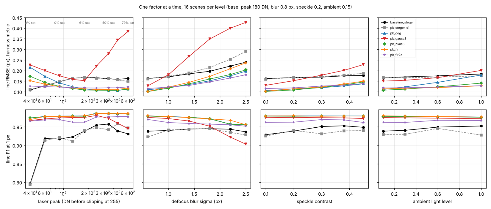
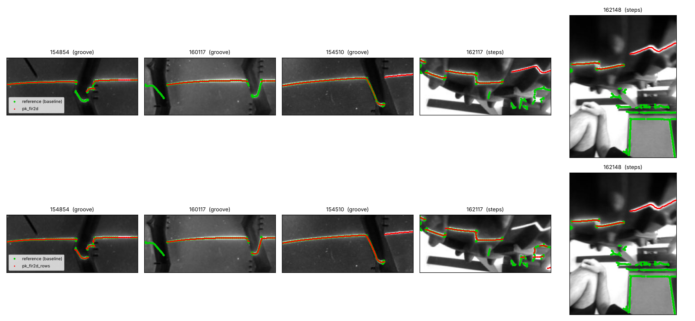
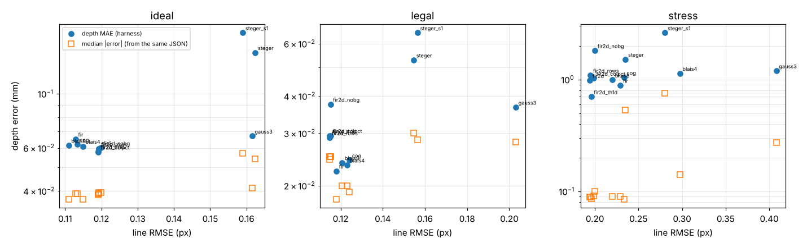

# Classical sub-pixel peak detectors for the laser line (branch `research/peak-detectors`)

**Question.** The baseline finds the line with a 2-D Steger ridge detector. Would a simpler detector that
works one image column at a time (the classic laser-triangulation approach, and far easier to run on an
STM32H7 camera board) be as accurate?

**Short answer.** Yes on the simulator, and it is more accurate there: every per-column detector except
the 3-point Gaussian has a lower line RMSE than Steger (0.11-0.12 px against 0.16 px on `ideal`) and
roughly halves the depth MAE on `ideal` and `legal`. On the real photos a plain per-column detector
loses the line inside grooves, and needs a second pass along the rows to get it back.
**Recommended: `pk_fir2d_rows`** (small 2-D Gaussian "matched filter", 3-point parabola, column pass + row pass).

Laser-off frames are not used anywhere here (`USES_OFF = False`).

## What was built

All detectors share one frame, `algos/peakcommon.py`, so that only the sub-pixel step differs:

1. background removal: `none` / `tophat` (15 px ellipse, same as the baseline) / `tophat1d` (15x1 vertical bar) / `colpct` (subtract each column's median);
2. candidates: local maxima down each column of the lightly smoothed image, up to 3 per column
   (a hooked groove profile or a glint puts two bright spots in one column), above
   `max(12 DN, 0.25 x median of the column maxima)`;
3. sub-pixel refinement (the detector under test);
4. the baseline's own `select_chain` (connected pieces near the main laser chain), unchanged.

| module | detector (step 3) |
|---|---|
| `pk_cog` | centre of gravity, +-4 px window, window minimum subtracted |
| `pk_gauss3` | 3-point Gaussian (parabola through the logs of the max and its two neighbours) |
| `pk_blais4`, `pk_blais8` | Blais-Rioux derivative filter (4th / 8th order), linear zero crossing |
| `pk_fir` | matched filter: column convolved with a Gaussian sigma 1.5 px, parabola through the top 3 samples |
| `pk_fir2d` | as `pk_fir` plus a Gaussian sigma 1.5 px ALONG the line (averages speckle) |
| `pk_fir2d_rows` | `pk_fir2d` + a second pass along the rows for near-vertical stretches (**recommended**) |
| `pk_fir2d_th1d`, `_colpct`, `_nobg` | `pk_fir2d` with the other background options |
| `pk_steger_s1` | the baseline Steger detector at sigma 1.0 instead of 1.5 |

Parameters (window sizes, sigmas, thresholds, background) were chosen on slices of `train`
(`experiments/peak-detectors/tune.py`, `grid1..4.py`). One exception, declared: the two row-pass
parameters of `pk_fir2d_rows` (`rows_ratio`, `rows_flank`) were chosen while looking at the 12 real
reference frames as well as `train`, so its real-photo numbers are slightly optimistic.

## Results (exact harness output, `results/*.json`)

`median abs err mm*` is NOT a harness column: I computed it from `_pred_mm` / `_true_mm` in the same JSON,
because the harness MAE on `stress` is dominated by a few gross failures (see P95).

| algorithm | set | line F1 | line RMSE px | depth MAE mm | median abs err mm* | P95 mm | bias mm | miss | false/frame | verdict acc | false pass |
|---|---|---|---|---|---|---|---|---|---|---|---|
| baseline_steger | ideal | 0.931 | 0.162 | 0.147 | 0.054 | 0.474 | 0.068 | 0.090 | 0.093 | 0.980 | 0.013 |
| baseline_steger | stress | 0.821 | 0.235 | 1.516 | 0.535 | 6.678 | 1.017 | 0.099 | 0.280 | 0.915 | 0.015 |
| baseline_steger | legal | 0.977 | 0.155 | 0.053 | 0.030 | 0.210 | -0.000 | 0.054 | 0.127 | 0.993 | 0.000 |
| pk_steger_s1 | ideal | 0.921 | 0.159 | 0.178 | 0.057 | 0.497 | 0.034 | 0.119 | 0.120 | 0.940 | 0.013 |
| pk_steger_s1 | stress | 0.697 | 0.280 | 2.618 | 0.753 | 10.775 | 1.906 | 0.188 | 0.455 | 0.865 | 0.025 |
| pk_steger_s1 | legal | 0.974 | 0.157 | 0.065 | 0.028 | 0.365 | 0.026 | 0.054 | 0.133 | 0.987 | 0.007 |
| pk_cog | ideal | 0.973 | 0.113 | 0.062 | 0.039 | 0.191 | 0.048 | 0.030 | 0.020 | 0.987 | 0.013 |
| pk_cog | stress | 0.907 | 0.234 | 1.043 | 0.085 | 8.576 | 0.428 | 0.072 | 0.205 | 0.930 | 0.005 |
| pk_cog | legal | 0.997 | 0.124 | 0.024 | 0.019 | 0.064 | -0.015 | 0.054 | 0.000 | 0.993 | 0.000 |
| pk_gauss3 | ideal | 0.968 | 0.162 | 0.067 | 0.041 | 0.197 | 0.053 | 0.034 | 0.020 | 0.987 | 0.013 |
| pk_gauss3 | stress | 0.839 | 0.408 | 1.195 | 0.272 | 7.960 | 0.697 | 0.063 | 0.450 | 0.830 | 0.020 |
| pk_gauss3 | legal | 0.994 | 0.203 | 0.037 | 0.028 | 0.105 | 0.008 | 0.047 | 0.000 | 0.993 | 0.007 |
| pk_blais4 | ideal | 0.972 | 0.115 | 0.061 | 0.037 | 0.180 | 0.049 | 0.034 | 0.020 | 0.987 | 0.013 |
| pk_blais4 | stress | 0.874 | 0.298 | 1.133 | 0.140 | 9.048 | 0.566 | 0.081 | 0.295 | 0.875 | 0.015 |
| pk_blais4 | legal | 0.997 | 0.123 | 0.023 | 0.020 | 0.058 | -0.012 | 0.051 | 0.007 | 0.987 | 0.007 |
| pk_blais8 | ideal | 0.973 | 0.111 | 0.061 | 0.037 | 0.181 | 0.048 | 0.034 | 0.020 | 0.987 | 0.013 |
| pk_blais8 | stress | 0.907 | 0.220 | 0.989 | 0.090 | 7.011 | 0.502 | 0.078 | 0.240 | 0.930 | 0.005 |
| pk_blais8 | legal | 0.997 | 0.121 | 0.024 | 0.020 | 0.064 | -0.015 | 0.051 | 0.007 | 0.993 | 0.000 |
| pk_fir | ideal | 0.975 | 0.113 | 0.065 | 0.039 | 0.198 | 0.053 | 0.030 | 0.000 | 0.987 | 0.013 |
| pk_fir | stress | 0.913 | 0.229 | 0.886 | 0.090 | 4.957 | 0.494 | 0.060 | 0.225 | 0.950 | 0.005 |
| pk_fir | legal | 0.997 | 0.118 | 0.022 | 0.018 | 0.054 | -0.012 | 0.051 | 0.000 | 0.993 | 0.000 |
| pk_fir2d | ideal | 0.962 | 0.119 | 0.060 | 0.040 | 0.176 | 0.039 | 0.037 | 0.013 | 0.987 | 0.013 |
| pk_fir2d | stress | 0.907 | 0.194 | 0.981 | 0.089 | 5.441 | 0.526 | 0.084 | 0.175 | 0.950 | 0.000 |
| pk_fir2d | legal | 0.995 | 0.115 | 0.029 | 0.025 | 0.068 | -0.024 | 0.054 | 0.007 | 0.993 | 0.000 |
| pk_fir2d_rows | ideal | 0.962 | 0.119 | 0.060 | 0.039 | 0.176 | 0.039 | 0.041 | 0.013 | 0.987 | 0.013 |
| pk_fir2d_rows | stress | 0.893 | 0.195 | 1.089 | 0.089 | 5.317 | 0.777 | 0.101 | 0.195 | 0.960 | 0.000 |
| pk_fir2d_rows | legal | 0.995 | 0.115 | 0.029 | 0.025 | 0.068 | -0.024 | 0.054 | 0.007 | 0.993 | 0.000 |
| pk_fir2d_th1d | ideal | 0.960 | 0.119 | 0.058 | 0.039 | 0.175 | 0.038 | 0.045 | 0.000 | 0.987 | 0.013 |
| pk_fir2d_th1d | stress | 0.902 | 0.196 | 0.699 | 0.086 | 2.192 | 0.239 | 0.090 | 0.115 | 0.945 | 0.000 |
| pk_fir2d_th1d | legal | 0.996 | 0.115 | 0.029 | 0.024 | 0.069 | -0.025 | 0.054 | 0.007 | 0.993 | 0.000 |
| pk_fir2d_colpct | ideal | 0.958 | 0.119 | 0.058 | 0.038 | 0.175 | 0.037 | 0.045 | 0.000 | 0.987 | 0.013 |
| pk_fir2d_colpct | stress | 0.834 | 0.199 | 1.024 | 0.091 | 7.167 | 0.495 | 0.122 | 0.340 | 0.900 | 0.000 |
| pk_fir2d_colpct | legal | 0.995 | 0.115 | 0.029 | 0.025 | 0.069 | -0.025 | 0.054 | 0.007 | 0.993 | 0.000 |
| pk_fir2d_nobg | ideal | 0.961 | 0.120 | 0.060 | 0.040 | 0.180 | 0.039 | 0.037 | 0.013 | 0.987 | 0.013 |
| pk_fir2d_nobg | stress | 0.817 | 0.200 | 1.811 | 0.100 | 10.674 | 1.317 | 0.131 | 0.475 | 0.930 | 0.000 |
| pk_fir2d_nobg | legal | 0.995 | 0.115 | 0.038 | 0.025 | 0.069 | -0.017 | 0.054 | 0.007 | 0.993 | 0.000 |
| oracle_line | ideal | 0.998 | 0.000 | 0.071 | 0.042 | 0.205 | 0.068 | 0.011 | 0.000 | 0.987 | 0.013 |
| oracle_line | stress | 0.998 | 0.000 | 0.108 | 0.063 | 0.344 | 0.069 | 0.006 | 0.005 | 1.000 | 0.000 |
| oracle_line | legal | 1.000 | 0.000 | 0.018 | 0.016 | 0.038 | 0.002 | 0.044 | 0.000 | 1.000 | 0.000 |

Real photos:

| algorithm | line_f1_ref | depth_mae_px | found_ref | repeat_pair_diff_px | usable_recall | false_measure |
|---|---|---|---|---|---|---|
| baseline_steger | 1.000 | 0.132 | 6/6 | 2.450 | 0.947 | 0.701 |
| pk_steger_s1 | 0.773 | 1.602 | 6/6 | 2.420 | 0.842 | 0.716 |
| pk_cog | 0.765 | 5.110 | 5/6 | 16.780 | 0.789 | 0.701 |
| pk_gauss3 | 0.769 | 1.264 | 5/6 | 2.510 | 0.789 | 0.761 |
| pk_blais4 | 0.763 | 5.139 | 5/6 | 16.890 | 0.789 | 0.701 |
| pk_blais8 | 0.765 | 5.159 | 5/6 | 16.850 | 0.737 | 0.687 |
| pk_fir | 0.730 | 5.203 | 5/6 | 17.200 | 0.737 | 0.716 |
| pk_fir2d | 0.729 | 4.899 | 5/6 | 15.790 | 0.737 | 0.687 |
| pk_fir2d_rows | 0.759 | 1.141 | 6/6 | 2.520 | 0.895 | 0.791 |
| pk_fir2d_th1d | 0.675 | 4.929 | 5/6 | 15.870 | 0.737 | 0.657 |
| pk_fir2d_colpct | 0.459 | 5.356 | 4/6 | 15.830 | 0.789 | 0.881 |
| pk_fir2d_nobg | 0.455 | 4.951 | 5/6 | 15.740 | 0.895 | 0.940 |

`ms_per_frame` from the harness is not in the table on purpose: it is wall-clock on a shared one-core
machine and was 2-4x inflated and unstable while other jobs ran (the committed baseline JSON says 24 ms,
my runs of per-column detectors read 45-90 ms). CPU time measured with `time.process_time`
(`experiments/peak-detectors/checks.py`, 320x240 frames, numpy on the PC):

| stage | CPU ms / frame |
|---|---|
| top-hat 15 px ellipse / 15x1 bar / column median | 1.36 / 0.23 / 1.49 |
| Gaussian smoothing, column only / column + row | 0.92 / 1.34 |
| `pk_cog`, `pk_blais8`, `pk_fir` complete | 3.3 - 3.4 |
| `pk_fir2d` / `pk_fir2d_rows` complete | 4.35 / 4.79 |
| `baseline_steger` complete (Steger points alone 9.76) | 11.0 |

So the per-column detectors cost about 0.3-0.45x of the baseline in numpy. These are PC numbers; nothing
was run on an STM32. What can be said for the MCU is structural: the recommended detector needs two short
separable FIR filters and 3-sample comparisons, no second derivatives, no eigenvalues and no square roots.

## Answers to the questions

**Which detector has the lowest sub-pixel RMSE?** On `ideal` and `legal` `pk_blais8`, `pk_cog`, `pk_fir`,
`pk_fir2d` are within 0.01 px of each other (0.111-0.124); on `stress` `pk_fir2d` is clearly best (0.194
against 0.220-0.235 for the others and 0.235 for the baseline). `pk_gauss3` is the worst (0.408 on stress).
Signed error is zero-mean for all of them (checks.py part A: |mean| <= 0.005 px), so the differences are noise, not bias.

**Does it carry over to depth?** Partly (figure `rmse_vs_depth.png`).
- From the baseline to any per-column detector: yes. `ideal` MAE 0.147 -> 0.060-0.065 mm, `legal` 0.053 -> 0.022-0.029 mm,
  `stress` median error 0.535 -> 0.085-0.090 mm. But most of that gain comes with the higher line F1 (0.96-0.97 against 0.93)
  and lower miss / false-groove rates, i.e. from coverage, not only from sub-pixel accuracy.
- Among the per-column detectors: no. Their 0.01 px differences in RMSE do not order the depth MAE, and on `ideal` they
  are already at the oracle (0.060-0.065 against 0.071 for the true line). They are *below* the oracle only because the
  default depth stage reads +0.068 mm too deep with a perfect line and the detectors' smoothing happens to read slightly
  shallower (bias +0.04-0.05): error cancellation, not a real advantage.
- On `stress` the MAE (0.7-1.2 mm) is set by a handful of gross failures (P95 2-9 mm: glints or paint taken for line),
  which are decided by background removal and chain selection, not by the peak detector.

**Degradation sweeps** (figure `sweeps.png`; `sweep.py`, 16 scenes per level, same scenes for all detectors):
- *Low signal* (peak 40 DN): `pk_fir2d` 0.127 px, `pk_fir` 0.152, `pk_blais8` 0.173, `pk_cog` 0.215, `pk_gauss3` 0.227.
  The baseline reads 0.108 but only because it drops most of the line (F1 0.80, the others 0.97): its 35 DN contrast floor
  keeps only the brightest stretches. RMSE is conditional on being found, so read it together with F1.
- *Saturation* (peak 250-600 DN, 25-79 % of line pixels clipped): centroid, Blais-Rioux and the matched filters are
  unaffected (0.106-0.123 px): a flat top is symmetric and they use the shoulders. `pk_gauss3` breaks (0.221 -> 0.384)
  because its three samples are all 255.
- *Blur* (sigma 0.6 -> 2.5 px): everything degrades; `pk_fir2d` least (0.115 -> 0.180), `pk_cog` 0.110 -> 0.197,
  `pk_blais8` 0.101 -> 0.203, `pk_fir` 0.102 -> 0.236 (its fixed 1.5 px kernel is then too narrow), baseline 0.163 -> 0.240,
  Steger at sigma 1.0 0.161 -> 0.290, `pk_gauss3` 0.128 -> 0.427.
- *Speckle* (0.1 -> 0.45): about +0.03-0.04 px for the good detectors (`pk_fir2d` 0.115 -> 0.139, `pk_cog` 0.105 -> 0.138),
  `pk_gauss3` 0.130 -> 0.228. The along-line smoothing of `pk_fir2d` only pays off at the high-speckle end.
- *Ambient light* (0.1 -> 1.0): `pk_cog` is the sensitive one (0.111 -> 0.179) because leftover background inside the
  window drags the centroid; `pk_fir`/`pk_fir2d` barely move (0.114 -> 0.128).
- Steger sits at ~0.16 px regardless of signal: about 0.05 px worse than the per-column detectors even in the easiest
  conditions. Lowering its sigma to 1.0 does not help (and is much worse on `stress`: F1 0.697).

**Background removal** (with `pk_fir2d`): it does not matter on `ideal`/`legal` (identical to 3 decimals) and matters a
lot elsewhere. `stress` F1: top-hat 0.907, 1-D top-hat 0.902, column median 0.834, none 0.817. Real `line_f1_ref`:
0.729 / 0.675 / 0.459 / 0.455, and without a top-hat the detector reports a depth on 88-94 % of the unusable photos
(bright table, window, hands). The cheap 1-D top-hat (0.23 ms) had the best `stress` depth numbers of all
(MAE 0.699, P95 2.192, false 0.115) but agrees less with the real references; I would re-test it once real photos
from the holder exist.

**Real photos.** No per-column detector reaches the baseline's agreement, by construction, but there is a real failure
behind the numbers (figure `real_frames.png`): `pk_cog`, `pk_blais*`, `pk_fir`, `pk_fir2d` find 5/6 grooves with a 5 px
mean depth error and a 16-17 px difference on the repeat pair. Cause (checked on 154854 and 160117): the points inside
the groove ARE detected (356 points before chain selection) but on the steep wall a column gives one point per column,
several px apart vertically, so `select_chain` (3 px linking) sees the hook as small separate pieces and discards them
(< 6 points). The depth stage then measures a partial groove. `pk_fir2d_rows` adds peaks along the rows where the line
is steep: 6/6 found, depth MAE 1.141 px, repeat pair 2.520 px (baseline 2.450), usable recall 0.895. Its false_measure
is higher (0.791 against 0.701): more points also means more "depths" on junk frames; this harness has no quality gate.
`pk_gauss3` happens to keep the hook on 154854 (repeat pair 2.510) but still misses 160117.

## Recommendation

**`pk_fir2d_rows`**: top-hat, 2-D Gaussian (sigma 1.5 px) response, peaks along columns (and along rows where the
line is steep), 3-point parabola, chain selection.
- Best line RMSE under blur, speckle and low signal; immune to saturation (the real line is saturated on 6 of the 12 reference frames' majority of samples).
- Depth on `ideal`/`legal` at the oracle level; `stress` verdict accuracy 0.960 with 0 false passes (baseline 0.915, 0.015).
- The only per-column variant that keeps the groove on all 6 real truck-tyre frames.
- About 0.45x the baseline's CPU time, and only FIR filters + comparisons.
If only simulator numbers mattered, plain `pk_fir2d` (no row pass) or `pk_blais8` would be equally good and simpler.

## Code excerpts

The detector itself: the smoothed response is the matched filter, the sub-pixel step is one parabola.
```python
def parabola3(W, off):                      # W: (N, 3) response samples around each column peak
    h = len(off) // 2
    a, b, c = W[:, h - 1], W[:, h], W[:, h + 1]
    den = a - 2 * b + c
    d = np.where(den < -1e-6, 0.5 * (a - c) / np.where(den < -1e-6, den, -1.0), 0.0)
    return np.clip(d, -1.0, 1.0)

resp = smooth(img, 1.5, 1.5)                # img = top-hat of the frame
thr = max(12.0, 0.25 * np.median(resp.max(axis=0)))
iv, iu = column_peaks(resp, thr, max_per_col=3)
v = iv + parabola3(*windows(resp, iv, iu, 1))
```
The row pass (same response, transposed), kept only where the line is steep and the point is not on the shoulder of a level line:
```python
ju, jv, u2, s2 = one_pass(img.T, resp.T, thr, c)          # peaks along the rows -> sub-pixel u
cuu = 2 * resp[jv, ju] - resp[jv, ju - 1] - resp[jv, ju + 1]
cvv = 2 * resp[jv, ju] - resp[jv - 1, ju] - resp[jv + 1, ju]
gv = 0.5 * np.abs(resp[jv + 1, ju] - resp[jv - 1, ju])
steep = (cuu > 2.0 * cvv) & (gv < 1.0 * cuu)
```

## What failed / negative results
- 3-point Gaussian on raw pixels: noisy (uses 3 pixels), and wrong on saturated or wide lines. Not usable here.
- Steger at sigma 1.0: no gain on easy sets, much worse on `stress`.
- No background removal and column-median subtraction: fine on clean frames, fail with glints, paint and real backgrounds.
- The row pass, first version (curvature test only): on `train` it made depth much worse (MAE 0.78 -> 1.96 mm) because
  speckle on the shoulders of the level line passed as "steep" points 1-3 px off the line. The flank test fixed most of it,
  but the final version is still slightly worse than `pk_fir2d` on `stress` (F1 0.893 against 0.907, miss 0.101 against 0.084).
- `max_per_col = 1` gave the lowest `train` depth MAE (0.303 against 0.520 mm on frames 240-540) with more misses
  (0.121 against 0.096). Not adopted because the real hooked profile needs more than one point per column; worth revisiting.

## Limitations
- One point per column is the wrong model on steep walls; the row pass is a patch. The real fix is probably in the chain
  selection (link over larger vertical gaps), which was outside this study and was left at the baseline's settings.
- Filter width is fixed at 1.5 px. The simulated line has sigma 0.8-2.8 px; the real hand-held photos have a line FWHM of
  4-10 px (sigma about 1.7-4 px, measured on the 12 reference frames). The kernel should be re-chosen on holder photos.
- Tuning used 240-300 `train` frames per grid and its depth MAE is noisy (outlier-driven), so parameter choices finer
  than "top-hat or not" are weakly supported.
- Sweeps use 16 scenes per level, one seed; differences below ~0.01 px are not significant.
- Runtime is numpy on a PC, not firmware.

## Things in the harness / simulator that can mislead (not patched, as required)
1. **`line_rmse_px` has a floor of about 0.058 px.** It is the distance to the nearest *sample* of the true line, and the
   samples are ~0.19 px apart in u. Exact points at integer columns (truth interpolated) score 0.058 on `ideal`
   (checks.txt, part D). So 0.11-0.12 px is nearer the floor than it looks, and detectors that put points at integer
   columns are affected differently from Steger's points. It also only counts points within 1 px, so it cannot see gross errors.
2. **`ms_per_frame` is wall-clock** and depends on what else is running (see runtime above).
3. **Real reference lines contain background.** On `photo_20261028_162148` most reference points lie on the table and
   box edges, and the clear laser segment at the top right is not in the reference; `162156` and `162117` have the same
   problem to a lesser degree (figure `real_frames.png`, right). A correct detector is scored P 0.54 / R 0.18 on 162148.
   Even the baseline's own detector with sigma 1.0 only reaches `line_f1_ref` 0.773, so this metric mostly measures
   "is it the baseline" and should not be used to rank detectors; the 6 groove depths are more meaningful.
4. **The oracle is not a ceiling for depth MAE** on `ideal` (several detectors score below it) because of the known
   +0.07 mm bias of the depth stage; small smoothing biases can cancel it.
5. **The simulated line is thin and rarely looks like the real one**: sigma 0.8-1.3 px on `ideal` against the 4-10 px FWHM,
   mostly saturated lines of the photos, and the dim-in-groove / hooked profile of the real grooves is milder in the simulator.
   Rankings among detectors at the 0.01 px level will not transfer.
6. Depth-stage RANSAC prints `RankWarning` for per-column points (two of the three sampled points can share a column).
   Harmless for the result (checks part B: the oracle depth is stable to 0.001 mm under re-sampling), just noisy.

Raw output of the side checks:
```
A. signed v error (px, + = detector reads lower in the image / deeper), points within 1 px of the truth
   baseline_steger  mean=-0.001 std=0.123 rms=0.123 n=19332
   pk_steger_s1     mean=-0.002 std=0.125 rms=0.125 n=18333
   pk_cog           mean=-0.000 std=0.079 rms=0.079 n=18987
   pk_gauss3        mean=+0.001 std=0.130 rms=0.130 n=18988
   pk_blais8        mean=-0.000 std=0.075 rms=0.075 n=18995
   pk_fir           mean=-0.004 std=0.075 rms=0.075 n=18973
   pk_fir2d         mean=-0.005 std=0.069 rms=0.070 n=18915
B. oracle line (truth[k::3]) -> default depth stage, 'stress' set
   phase 0: depth_mae_mm=0.108 p95=0.344 miss=0.006 false=0.005 verdict=1.000
   phase 1: depth_mae_mm=0.108 p95=0.346 miss=0.006 false=0.005 verdict=1.000
   phase 2: depth_mae_mm=0.109 p95=0.343 miss=0.006 false=0.005 verdict=1.000
C. CPU ms per 320x240 frame (mean of 60 ideal frames)
   background tophat    1.36
   background tophat1d  0.23
   background colpct    1.49
   smooth sigma_v=1.5           0.92
   smooth sigma_v=1.5 + u=1.5   1.34
   pk_cog         no chain 2.69   with chain 3.29
   pk_gauss3      no chain 2.49   with chain 4.73
   pk_blais8      no chain 2.60   with chain 3.37
   pk_fir         no chain 2.61   with chain 3.43
   pk_fir2d       no chain 2.96   with chain 4.35
   pk_fir2d_rows  no chain 3.38   with chain 4.79
   baseline_steger steger_points only 9.76   full 11.01
   pk_steger_s1   steger_points only 9.27   full 9.45
D. harness line_rmse_px of EXACT points at integer columns (truth interpolated), ideal set: 0.058  (median truth spacing in u 0.191 px)
```

## Files
- `algos/peakcommon.py` (shared frame), `algos/pk_*.py` (one small module per detector)
- `experiments/peak-detectors/`: `tune.py` + `grid*.py` (train-set tuning), `sweep.py` + `sweep.json`, `checks.py` + `checks.txt`, `figs.py`
- `results/pk_*.json`
- figures: `figs/peak-detectors/sweeps.png`, `real_frames.png`, `rmse_vs_depth.png`




