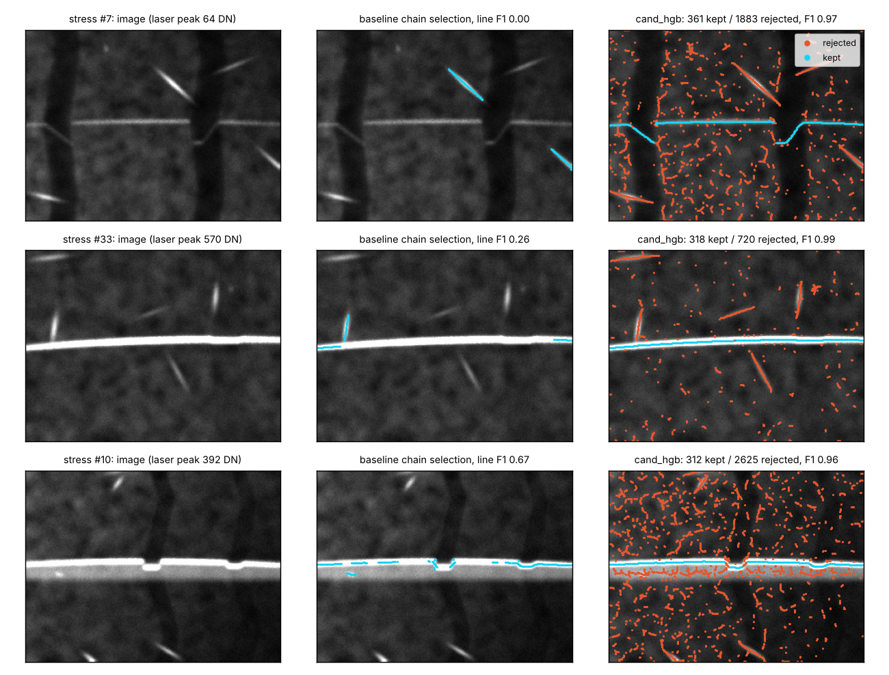
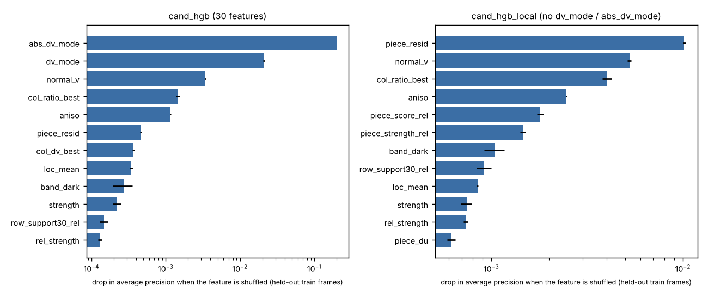
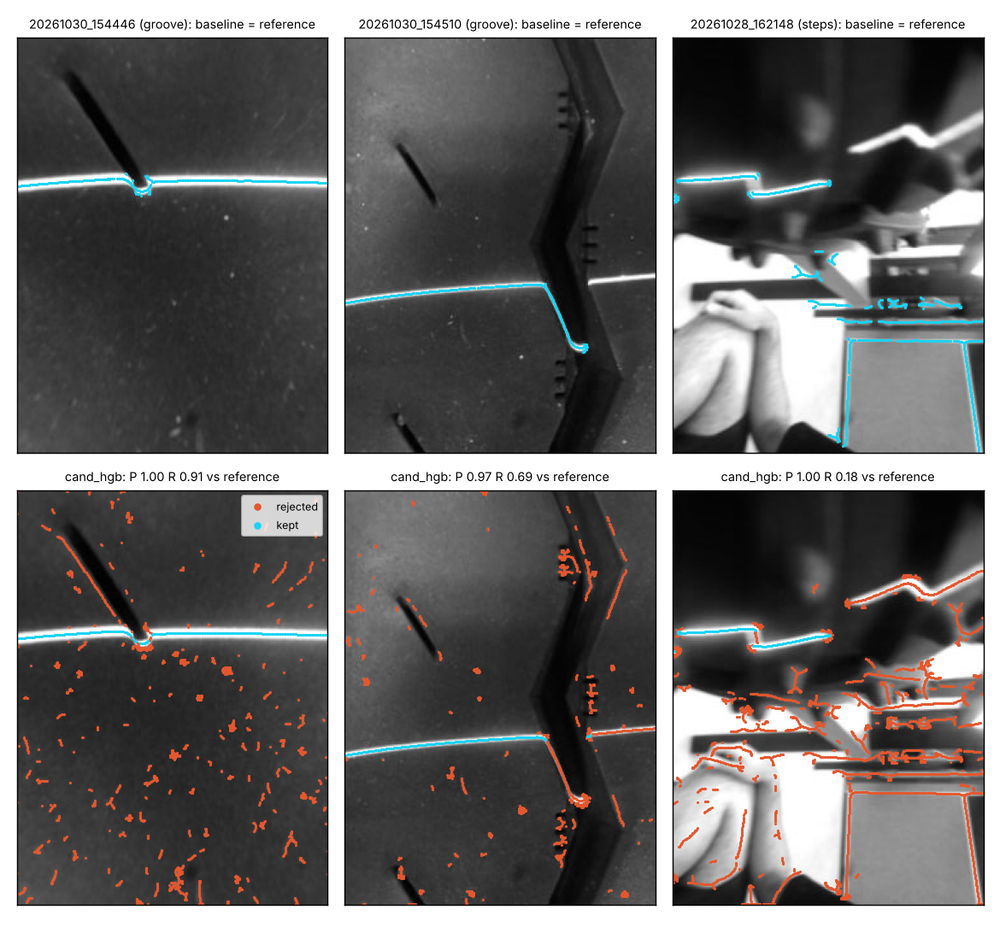

# pixel-classifier: a learned selector for laser-line points

Branch `research/pixel-classifier`. Question: can classic machine learning tell laser points from
everything else that is thin and bright, better than the baseline's hand-written chain selection?

**Short answer.** In simulation, yes, by a wide margin. On the real hand-held photos, no: a model
trained only on the simulator throws away the deep part of real grooves and the lug-tyre staircases.
Do not ship it until the training data covers what the real line looks like.

## What was built (formulation 2, "candidate classifier")
1. **Candidates** - the same Steger ridge maths as `pipeline/single_frame.py`, but permissive
   (top-hat contrast > 6 instead of 35, relative strength > 0.08 instead of 0.3). On `train` this keeps
   98.3 % of the true line (0.5 px grid, 1 px tolerance) plus about 2 clutter points for every line point
   (1 319 500 candidates in 1200 frames, 32.5 % on the line).
2. **Features** - 30 numbers per candidate (`algos/cand_clf.py: features`): own strength / contrast /
   width / orientation, local mean and std, ridge support along the row, what else is in the same column,
   statistics of its connected piece, and distance from the "modal row" (the row most column-winners agree on).
3. **Classifier** - label = within 1 px of `truth["u"], truth["v"]` (1-2 px ring ignored). Trained on
   300 000 candidates from `train` frames 0-899; frames 900-1199 held out for validation, threshold
   choice and permutation importance. Nothing was fitted or tuned on `ideal` / `stress` / `legal` / real.
4. **Select** - keep candidates with P >= threshold; depth = the shared `bench/depth.py`.

Variants scored:
| name | model | size |
|---|---|---|
| `cand_hgb` | HistGradientBoosting, 120 trees x 31 leaves, all 30 features, P >= 0.95 | 487 kB pickle |
| `cand_hgb_local` | same, without `dv_mode` / `abs_dv_mode`, P >= 0.9 | 483 kB |
| `cand_lr` | logistic regression on signed-log features, P >= 0.9 | 2.3 kB JSON (31 weights) |
| `cand_thresh` | **simplest alternative**: one cut on the best single feature, `col_ratio_best >= 0.815` ("at least 81 % as strong as the strongest candidate in its column") | 82 bytes |

Formulation 1 (per-pixel filter bank -> probability map) was **not done**: time went into the
sim-to-real question instead. Nothing in this note is evidence for or against it.

## Results (exact harness output, `results/cand_*.json`)
| algorithm | set | line F1 | RMSE px | depth MAE mm | P95 mm | bias mm | miss | false/frame | verdict acc | false pass | ms/frame |
|---|---|---|---|---|---|---|---|---|---|---|---|
| baseline_steger | ideal | 0.931 | 0.162 | 0.147 | 0.474 | 0.068 | 0.090 | 0.093 | 0.980 | 0.013 | 24.4 |
| cand_hgb | ideal | 0.986 | 0.172 | 0.154 | 0.527 | 0.142 | 0.015 | 0.000 | 0.987 | 0.013 | 68.9 |
| cand_hgb_local | ideal | 0.982 | 0.172 | 0.266 | 0.852 | 0.256 | 0.015 | 0.000 | 0.987 | 0.013 | 64.1 |
| cand_lr | ideal | 0.983 | 0.169 | 0.132 | 0.576 | 0.120 | 0.015 | 0.000 | 0.987 | 0.013 | 49.5 |
| cand_thresh | ideal | 0.985 | 0.133 | 0.083 | 0.287 | 0.064 | 0.015 | 0.000 | 0.987 | 0.013 | 52.2 |
| baseline_steger | stress | 0.821 | 0.235 | 1.516 | 6.678 | 1.017 | 0.099 | 0.280 | 0.915 | 0.015 | 25.1 |
| cand_hgb | stress | **0.960** | 0.227 | **0.273** | **0.561** | -0.007 | 0.024 | **0.050** | 0.970 | 0.000 | 78.2 |
| cand_hgb_local | stress | 0.946 | 0.225 | 0.475 | 0.819 | 0.265 | 0.042 | 0.065 | 0.965 | 0.000 | 68.7 |
| cand_lr | stress | 0.943 | 0.227 | 0.725 | 4.066 | 0.013 | 0.021 | 0.140 | 0.975 | 0.005 | 47.9 |
| cand_thresh | stress | 0.877 | 0.221 | 16.432 | 119.160 | 16.242 | 0.015 | 0.630 | 0.975 | 0.010 | 48.9 |
| baseline_steger | legal | 0.977 | 0.155 | 0.053 | 0.210 | -0.000 | 0.054 | 0.127 | 0.993 | 0.000 | 22.0 |
| cand_hgb | legal | 0.993 | 0.155 | 0.044 | 0.083 | -0.008 | 0.051 | 0.000 | 0.987 | 0.000 | 73.6 |
| cand_hgb_local | legal | 0.991 | 0.155 | 0.071 | 0.451 | 0.021 | 0.051 | 0.000 | 0.987 | 0.000 | 71.3 |
| cand_lr | legal | 0.994 | 0.153 | 0.033 | 0.075 | -0.021 | 0.051 | 0.000 | 0.987 | 0.000 | 39.6 |
| cand_thresh | legal | 0.995 | 0.139 | 0.030 | 0.073 | -0.024 | 0.051 | 0.000 | 0.987 | 0.000 | 52.5 |

Real photos (86; 12 references; 6 truck-groove depths; 19 usable / 67 unusable by eye):
| algorithm | line_f1_ref | depth_mae_px | found_ref | repeat_pair_diff_px | usable_recall | false_measure | ms/frame |
|---|---|---|---|---|---|---|---|
| baseline_steger | 1.000 (by construction) | 0.132 | 6/6 | 2.450 | 0.947 | 0.701 | 18.8 |
| cand_hgb | 0.649 | 8.096 | 3/6 | - | 0.579 | 0.403 | 66.7 |
| cand_hgb_local | 0.592 | 2.334 | 2/6 | - | 0.632 | 0.567 | 66.4 |
| cand_lr | 0.702 | 7.073 | 6/6 | 5.490 | 0.789 | 0.179 | 35.5 |
| cand_thresh | 0.772 | 67.153 | 6/6 | 2.390 | 1.000 | 0.866 | 44.3 |

The ms/frame columns were measured while another job shared the 2 cores; see "Runtime" for clean timings.

### Reading the table
- **Stress, simulated:** the learned selector beats the hand-written one on every stress column:
  line F1 0.821 -> 0.960, false grooves 0.280 -> 0.050 per frame, miss 0.099 -> 0.024, depth MAE
  1.516 -> 0.273 mm, P95 6.678 -> 0.561 mm (the oracle line gets 0.108 / 0.344 mm).
- **Ideal / legal:** line F1 and miss improve, false grooves go to 0. Two small costs: ideal depth
  bias +0.142 mm (baseline +0.068), and legal verdict accuracy 0.987 vs 0.993 (one frame of 150).
- **The simplest alternative is not embarrassed on clean frames.** One cut on `col_ratio_best`
  matches or beats the boosted model on `ideal` and `legal` (ideal depth MAE 0.083 mm, the best
  of all). It collapses on `stress` (0.63 false grooves per frame, depth MAE 16 mm): a glint that is the
  strongest thing in its column passes. So the learning only earns its keep on clutter.
- **Logistic regression** (31 weights) gets most of the stress line gain (F1 0.943) but keeps 0.140
  false grooves per frame and a 4 mm P95.


*Three of the baseline's worst frames among the first 80 of `stress`. Blue = kept, red = rejected
candidates. Row 1: dim laser (64 DN); the baseline picks a glint as "the main chain".*

## Which features matter
Permutation importance on held-out `train` frames (drop in average precision, 60 000 candidates, 3 repeats):

| cand_hgb | drop | cand_hgb_local | drop |
|---|---|---|---|
| abs_dv_mode | 0.1996 | piece_resid (straightness of the piece) | 0.0102 |
| dv_mode | 0.0208 | normal_v (ridge runs left-right) | 0.0053 |
| normal_v | 0.0034 | col_ratio_best | 0.0040 |
| col_ratio_best | 0.0015 | aniso (line-like, not blob-like) | 0.0025 |
| aniso | 0.0012 | piece_score_rel | 0.0018 |
| piece_resid | 0.0005 | piece_strength_rel | 0.0015 |



The full model leans almost entirely on **"how far is this point from the row where most columns put
their strongest ridge"**. That is a real property of the product (the holder fixes where the line
falls), but it is also the simulator's most rigid property (see below). Without those two features the
point-level validation score barely moves (AP 0.9994 -> 0.9976) but stress depth MAE goes 0.273 -> 0.475 mm.
Caveat: features are correlated, so permutation importance under-rates the ones that have stand-ins
(strength, contrast, row support all rank near zero although each alone gives a point F1 of 0.85-0.88).
Best single features alone (held-out point F1): col_ratio_best 0.908, col_rank 0.885, band_dark 0.876,
rel_strength 0.875.

## Sim-to-real

*Top: baseline output (= the reference). Bottom: cand_hgb. Left: shallow groove, fine. Middle: the
44 px deep groove wall and floor are rejected. Right: a "steps" reference.*

Measured:
- Per-frame against the 12 references, cand_hgb has precision 0.84-1.00 everywhere, but recall
  0.69-0.91 on the 6 truck-groove frames and only 0.17-0.44 on the 6 lug-step frames.
- It reports a depth on only 3 of the 6 groove frames, and those are too shallow (8.27 vs 10.63,
  23.34 vs 36.40, 20.00 vs 28.87 px): the points it drops are the groove bottoms.
- No threshold fixes this. Sweeping P from 0.95 down to 0.5, adding hysteresis, or using the classifier
  only as a pre-filter before the baseline's chain growth all gave found_ref 6/6 only together with
  depth errors of 10-20 px (`experiments/pixel-classifier/hyst.py`, `hybrid.py`; real used as a
  diagnostic, nothing was selected on it).
- `false_measure` does drop: 0.701 -> 0.403 (hgb) and 0.179 (lr). But `usable_recall` drops too
  (0.947 -> 0.579 / 0.789), so this is mostly "finds less line everywhere", not a real quality gate.

Why (measured on the data, the causal link is my inference):
- In `train` the true line's median row is 115.1 +- 0.8 px (range 113.2-118.5) and the line never goes
  more than 30.5 px below it (95 % of frames: < 26.5 px). In the real references the line sits anywhere
  from row 83 to 218, is tilted, and the groove floors are 29-44 px below the surface line on 5 of the 6
  truck frames. The model has never seen a line point that far from the modal row, or a wall that long.
- Real walls are long steep diagonal runs; simulated walls are 8-22 degrees from vertical and at
  most ~30 px tall, so `normal_v` and `piece_resid` also vote "not laser" on real walls.
- Lug-tyre staircases do not exist in the simulator at all.

## Runtime and size
Clean single-thread timing on 60 stress frames (1459 candidates per frame on average):
candidates 6.9 ms, features 4.5 ms, HGB predict 26.0 ms, LR predict 0.3 ms; the whole baseline
extractor 14.4 ms. So ~37 ms (HGB) or ~12 ms (LR) per frame on the laptop before the depth stage.

STM32H7 (inference, not measured): the classifier itself is not the problem. LR is 31
multiply-adds per candidate. The HGB model is 120 trees / 7320 nodes: ~100 kB as C tables, about
120 x 5 comparisons per candidate, ~1 M comparisons per frame. The cost is the front end shared with
the baseline (15 px top-hat, two Gaussian-Hessian passes in float on 320x240, connected components),
which needs a few float frame buffers; plausible at a few frames per second on an H7 with external RAM
(OpenMV H7 Plus), but someone has to port and time it. Until then: laptop side.

## Limitations
- Trained and validated on one simulator; the real result above shows what that is worth.
- Threshold 0.95 was the top of the grid I searched on held-out train frames (still improving there).
- The real references come from the baseline, so "disagreement" is not always "error" (next section).
- `features` uses frame-level normalisers (99.7th percentile strength, strongest piece, modal row): one
  huge glint or a paint stripe that wins the modal row changes every point's features.
- No per-pixel classifier, no random forest comparison, no retraining with wider simulated geometry.

## Things in the harness / simulator that I think mislead
1. **The simulated line is always in the same place.** Median row 115.1 +- 0.8 px over 1200 `train`
   frames. Any learned method can (and mine did) learn "laser = near the modal row, at most 30 px
   below it". Stress numbers for learned methods are therefore optimistic. Suggest randomising
   stand-off / laser angle / camera pitch in a `train` v2, grooves up to ~50 px of line shift, and
   steep long walls.
2. **At least one "steps" reference is not a laser line.** In `photo_20261028_162148` the reference
   (= baseline output) traces the outline of a grey box and bench clutter (right column of the real
   figure); only the top-left staircase looks like laser to me. cand_hgb keeps just that part and is
   scored recall 0.18. I checked this one frame by eye, not all six.
3. **`false_measure` rewards finding nothing.** With no usable flag, any extractor that returns fewer
   points scores better on it. Read it together with `usable_recall`.
4. **Real `depth_mae_px` uses the deepest predicted groove**, so one clutter excursion sets the
   error (cand_thresh: 67 px) and a missed groove is not counted in the mean at all (cand_hgb_local's
   2.334 px is over 2 frames).
5. Small: `depth_mae_mm` on `stress` is dominated by a few huge values when clutter gets through
   (cand_thresh P95 119 mm is the calibration polynomial extrapolating); P95 and false/frame say more.

## Code that carries the idea
Feature construction (excerpt, `algos/cand_clf.py`):
```python
# ridge strength of CANDIDATES only, spread +-2 rows, then averaged along the row:
# the laser has neighbours to its left and right, a glint or a spike does not
Sc = cv2.dilate(np.where(c["ok"], S, 0).astype(np.float32), np.ones((5, 1), np.uint8))
sup10, sup30 = cv2.blur(Sc, (21, 1)), cv2.blur(Sc, (61, 1))
# --- column statistics
order = np.lexsort((-s, iu))                               # by column, strongest first
first = np.r_[True, np.diff(iu[order]) != 0]
start = np.maximum.accumulate(np.where(first, np.arange(n), 0))
rank = np.empty(n, np.float32); rank[order] = np.arange(n) - start
best = order[start]                                        # index of the column's strongest candidate
v_best = np.empty(n, np.float32); v_best[order] = c["v"][best]
s_best = np.empty(n, np.float32); s_best[order] = s[best]
# --- the row most candidates' column-winners agree on (a 1-number stand-in for 'the main chain')
vb = c["v"][rank == 0]
hist = np.bincount(np.clip(vb.astype(int), 0, h - 1), minlength=h).astype(np.float32)
mode = float(np.argmax(np.convolve(hist, np.ones(5), "same")))
```
Classify and select (this replaces `select_chain`):
```python
def extract_line(gray, off=None, return_all=False):
    c = candidates(gray)                      # permissive Steger points
    F = features(c)                           # (n, 30)
    prob = predict(F) if len(F) else np.zeros(0)
    keep = prob >= _load()["thresh"]          # 0.95 for cand_hgb
    return {"u": c["u"][keep], "v": c["v"][keep], "strength": F[keep, 0], "prob": prob[keep]}
```

## Reproduce (from `research/`, OMP_NUM_THREADS=1)
```
python experiments/pixel-classifier/build.py train            # features -> cache/train.npz (100 MB, untracked)
python experiments/pixel-classifier/train.py                  # hgb, lr, single-feature threshold, importance
python experiments/pixel-classifier/train_variant.py hgb_local dv_mode,abs_dv_mode
python experiments/pixel-classifier/tune.py --write           # thresholds on train frames 900..1199
python -m bench.run algos.cand_clf --out results/cand_hgb.json     # also cand_hgb_local, cand_lr, cand_thresh
python experiments/pixel-classifier/figs.py
```
