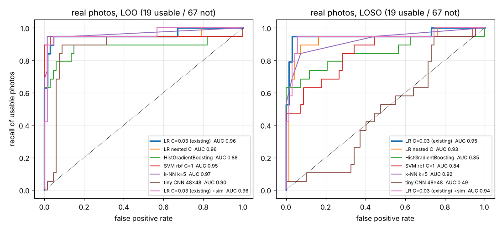
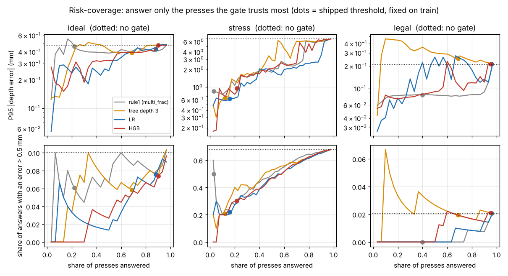
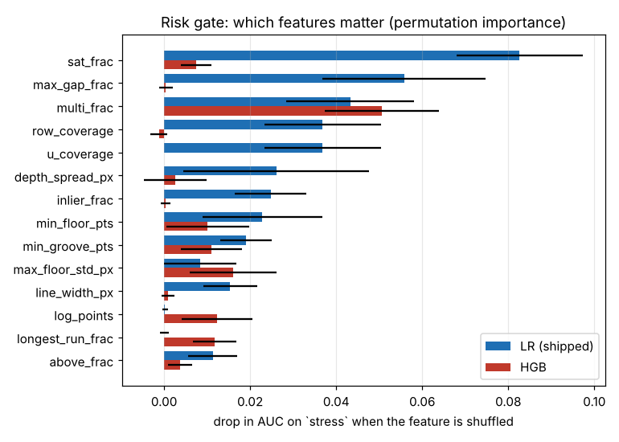

# Quality gate: "give a trustworthy depth, or say retake"

Branch `research/quality-gate`. Code: `algos/gate_features.py`, `algos/gated_baseline.py`, `algos/gated_frame_only.py`,
`experiments/quality-gate/{build,part_a,part_b,fit_frame,figs}.py`. Models: `models/frame_lr.json`, `models/risk_lr.json` (4 kB together).
Reproduce (from `research/`, `OMP_NUM_THREADS=1`): `build.py` (3 min) -> `part_b.py` (1 min) -> `fit_frame.py` -> `part_a.py` (15 min, the CNN is the slow part) -> `figs.py`.

## Summary (what was measured)
- **Two different questions need two different gates.** The frame gate trained on real photos ("is there a laser line on a
  tyre?") accepts 97-100 % of simulated laser-on frames and is blind to measurement error (AUC 0.53 for "good vs bad
  measurement" on `stress`). The risk gate trained on simulation ("is a depth wrong by > 0.5 mm?") rejects 17 of the 19 usable
  hand-held photos. Neither replaces the other.
- **A. Nothing beats the regularised logistic regression on the 86 real photos.** All tabular models have overlapping AUC
  intervals (about 0.85-1.00); the tiny CNN is clearly worse on an unseen day (AUC 0.49). But the published
  "precision 0.82" of the existing gate is optimistic: with C chosen inside the training folds the false-positive rate on an
  unseen day is 0.24 [0.14, 0.36], not 0.09 [0.03, 0.18].
- **B. The risk gate works, at a high price in coverage on bad days.** Threshold fixed on `train`; on `stress` it answers 16 %
  of presses and the depth error falls from MAE 1.516 / P95 6.678 mm to MAE 0.136 / P95 0.634 mm. On `ideal` it answers 88 %
  (P95 0.474 -> 0.433), on `legal` 96 % (unchanged). There is no useful "answer 80 %" point on `stress`: 68 % of the
  baseline's answers there are wrong by more than 0.5 mm.

## Results table (harness, exactly as printed)
| algorithm | set | line F1 | RMSE px | depth MAE mm | P95 mm | miss | false/frame | verdict acc | false pass |
|---|---|---|---|---|---|---|---|---|---|
| baseline_steger | ideal | 0.931 | 0.162 | 0.147 | 0.474 | 0.090 | 0.093 | 0.980 | 0.013 |
| gated_frame_only | ideal | 0.931 | 0.162 | 0.147 | 0.474 | 0.090 | 0.093 | 0.980 | 0.013 |
| **gated_baseline** | ideal | 0.931 | 0.162 | 0.107 | 0.433 | 0.187 | 0.060 | 0.867 | 0.013 |
| baseline_steger | stress | 0.821 | 0.235 | 1.516 | 6.678 | 0.099 | 0.280 | 0.915 | 0.015 |
| gated_frame_only | stress | 0.821 | 0.235 | 1.378 | 6.277 | 0.107 | 0.265 | 0.890 | 0.015 |
| **gated_baseline** | stress | 0.821 | 0.235 | 0.136 | 0.634 | 0.851 | 0.015 | 0.215 | 0.005 |
| baseline_steger | legal | 0.977 | 0.155 | 0.053 | 0.210 | 0.054 | 0.127 | 0.993 | 0.000 |
| gated_frame_only | legal | 0.977 | 0.155 | 0.053 | 0.210 | 0.054 | 0.127 | 0.993 | 0.000 |
| **gated_baseline** | legal | 0.977 | 0.155 | 0.053 | 0.212 | 0.061 | 0.127 | 0.993 | 0.000 |

Read `miss` and `verdict acc` of the gated rows with care: the harness has no "retake" outcome on simulated sets. A frame the
gate withholds is scored as missed grooves **and** as a "not PASS" verdict, so abstaining on a tyre that is truly legal counts
as a wrong verdict. `stress` 0.215 means "the device answered 16 % of presses", not "it got 78 % of verdicts wrong"
(unsafe verdicts fell from 3 to 1 of 200).

Real photos (`gated_baseline` and `gated_frame_only` are identical here: stage 2 is skipped without a calibration):

| | usable_recall | false_measure | how obtained |
|---|---|---|---|
| baseline, no gate | 0.947 (18/19) | 0.701 (47/67) | harness |
| gated_baseline, **harness** | 0.895 (17/19) | 0.075 (5/67) | **IN-SAMPLE**: model fitted on all 86 labels, scored on the same 86 |
| same model family, **LOO** | 0.895 (17/19) [0.67, 0.99] | 0.075 (5/67) [0.02, 0.17] | cross-validated, C = 0.03 fixed |
| same model family, **leave-one-session-out** | 0.895 (17/19) [0.67, 0.99] | 0.060 (4/67) [0.02, 0.15] | cross-validated, C = 0.03 fixed (C itself was picked on this CV in October) |
| LR with C chosen inside each fold, LOSO | 0.895 (17/19) [0.67, 0.99] | 0.179 (12/67) [0.10, 0.29] | fully nested: the honest "new day" number |

Other harness numbers on real are unchanged from the baseline (line_f1_ref 1.000, depth_mae_px 0.132, found_ref 6/6,
repeat_pair_diff_px 2.450) because the line and depth stages are the baseline's. Intervals are exact binomial (Clopper-Pearson) 95 %.
In-sample and LOO happen to coincide (5/67); that is a coincidence of 12 weights on 86 photos, not evidence that in-sample scoring is safe.

## Part A: "is this photo usable?" (86 real photos, 19 usable)
Features: the 12 of `pipeline/frame_classifier.py`, computed on the canonical (rotated) image. Protocols: leave-one-out
(86 folds) and leave-one-session-out by date (4 sessions: 8 Oct 2 photos, 19 Oct 30, 28 Oct 33, 30 Oct 21; **only 28 and
30 Oct contain usable photos**, so LOSO is really "train on one tyre day, test on the other"). Hyper-parameters: every row
is a fixed setting written down before scoring, except "LR C=0.03 (existing)" (C tuned on this LOSO in October) and
"LR nested C" (C from {0.01 .. 3} by inner stratified 5-fold log-loss inside each training fold). Threshold 0.5 everywhere.
Recall and FPR intervals: exact binomial; AUC interval: bootstrap over photos (2000 resamples) of the out-of-fold scores.
"+sim": 43 simulated positives (laser-on `train` frames, laser peak 100-250 DN, baseline found a groove) and 43 simulated
negatives (21 very dim laser < 55 DN, 22 laser-OFF frames) appended to every training fold, never to a test fold.

**Leave-one-session-out** (the honest one):

| model | acc | prec | recall [95 % CI] | FPR [95 % CI] | AUC [95 % CI] | tp fp fn tn |
|---|---|---|---|---|---|---|
| hand rule | 0.90 | 1.00 | 0.53 [0.29,0.76] | 0.00 [0.00,0.05] | 0.763 [0.65,0.88] | 10 0 9 67 |
| LR C=0.03 (existing) | 0.92 | 0.75 | 0.95 [0.74,1.00] | 0.09 [0.03,0.18] | 0.953 [0.86,1.00] | 18 6 1 61 |
| LR C=0.03 +sim | 0.90 | 0.92 | 0.58 [0.33,0.80] | 0.01 [0.00,0.08] | 0.943 [0.85,1.00] | 11 1 8 66 |
| LR C=1 (untuned) | 0.85 | 0.60 | 0.95 [0.74,1.00] | 0.18 [0.10,0.29] | 0.940 [0.85,0.99] | 18 12 1 55 |
| LR C=1 +sim | 0.92 | 0.77 | 0.89 [0.67,0.99] | 0.07 [0.02,0.17] | 0.947 [0.86,1.00] | 17 5 2 62 |
| LR nested C | 0.80 | 0.53 | 0.95 [0.74,1.00] | 0.24 [0.14,0.36] | 0.929 [0.83,0.99] | 18 16 1 51 |
| LR nested C +sim | 0.86 | 0.64 | 0.84 [0.60,0.97] | 0.13 [0.06,0.24] | 0.937 [0.84,1.00] | 16 9 3 58 |
| random forest (existing) | 0.85 | 0.61 | 0.89 [0.67,0.99] | 0.16 [0.08,0.27] | 0.933 [0.84,0.99] | 17 11 2 56 |
| random forest +sim | 0.93 | 1.00 | 0.68 [0.43,0.87] | 0.00 [0.00,0.05] | 0.943 [0.86,1.00] | 13 0 6 67 |
| HistGradientBoosting | 0.85 | 0.65 | 0.68 [0.43,0.87] | 0.10 [0.04,0.20] | 0.848 [0.70,0.96] | 13 7 6 60 |
| HistGradientBoosting +sim | 0.86 | 0.68 | 0.68 [0.43,0.87] | 0.09 [0.03,0.18] | 0.886 [0.76,0.97] | 13 6 6 61 |
| SVM rbf C=1 | 0.87 | 1.00 | 0.42 [0.20,0.67] | 0.00 [0.00,0.05] | 0.842 [0.72,0.94] | 8 0 11 67 |
| SVM rbf C=1 +sim | 0.95 | 1.00 | 0.79 [0.54,0.94] | 0.00 [0.00,0.05] | 0.955 [0.86,1.00] | 15 0 4 67 |
| k-NN k=5 | 0.91 | 0.87 | 0.68 [0.43,0.87] | 0.03 [0.00,0.10] | 0.924 [0.83,0.99] | 13 2 6 65 |
| k-NN k=5 +sim | 0.91 | 0.87 | 0.68 [0.43,0.87] | 0.03 [0.00,0.10] | 0.843 [0.72,0.96] | 13 2 6 65 |
| tiny CNN 48x48 (mean of 3 seeds) | 0.56 | 0.12 | 0.16 [0.03,0.40] | 0.33 [0.22,0.45] | 0.489 [0.35,0.63] | 3 22 16 45 |
| tiny CNN 48x48 +sim | 0.80 | 0.60 | 0.32 [0.13,0.57] | 0.06 [0.02,0.15] | 0.771 [0.63,0.90] | 6 4 13 63 |

**Leave-one-out** (the CNN rows are stratified 10-fold, one seed: 86 CNN fits were too slow on the shared machine):

| model | acc | prec | recall [95 % CI] | FPR [95 % CI] | AUC [95 % CI] | tp fp fn tn |
|---|---|---|---|---|---|---|
| hand rule | 0.90 | 1.00 | 0.53 [0.29,0.76] | 0.00 [0.00,0.05] | 0.763 [0.65,0.88] | 10 0 9 67 |
| LR C=0.03 (existing) | 0.91 | 0.72 | 0.95 [0.74,1.00] | 0.10 [0.04,0.20] | 0.958 [0.88,1.00] | 18 7 1 60 |
| LR C=0.03 +sim | 0.93 | 0.93 | 0.74 [0.49,0.91] | 0.01 [0.00,0.08] | 0.961 [0.88,1.00] | 14 1 5 66 |
| LR C=1 (untuned) | 0.97 | 0.90 | 0.95 [0.74,1.00] | 0.03 [0.00,0.10] | 0.955 [0.86,1.00] | 18 2 1 65 |
| LR C=1 +sim | 0.97 | 0.94 | 0.89 [0.67,0.99] | 0.01 [0.00,0.08] | 0.967 [0.90,1.00] | 17 1 2 66 |
| LR nested C | 0.94 | 0.82 | 0.95 [0.74,1.00] | 0.06 [0.02,0.15] | 0.957 [0.86,1.00] | 18 4 1 63 |
| LR nested C +sim | 0.94 | 0.94 | 0.79 [0.54,0.94] | 0.01 [0.00,0.08] | 0.971 [0.92,1.00] | 15 1 4 66 |
| random forest (existing) | 0.97 | 0.94 | 0.89 [0.67,0.99] | 0.01 [0.00,0.08] | 0.954 [0.86,1.00] | 17 1 2 66 |
| random forest +sim | 0.93 | 0.88 | 0.79 [0.54,0.94] | 0.03 [0.00,0.10] | 0.955 [0.88,1.00] | 15 2 4 65 |
| HistGradientBoosting | 0.90 | 0.81 | 0.68 [0.43,0.87] | 0.04 [0.01,0.13] | 0.882 [0.74,0.99] | 13 3 6 64 |
| HistGradientBoosting +sim | 0.92 | 0.88 | 0.74 [0.49,0.91] | 0.03 [0.00,0.10] | 0.908 [0.79,0.99] | 14 2 5 65 |
| SVM rbf C=1 | 0.97 | 1.00 | 0.84 [0.60,0.97] | 0.00 [0.00,0.05] | 0.946 [0.82,1.00] | 16 0 3 67 |
| SVM rbf C=1 +sim | 0.97 | 1.00 | 0.84 [0.60,0.97] | 0.00 [0.00,0.05] | 0.962 [0.87,1.00] | 16 0 3 67 |
| k-NN k=5 | 0.93 | 0.93 | 0.74 [0.49,0.91] | 0.01 [0.00,0.08] | 0.967 [0.89,1.00] | 14 1 5 66 |
| k-NN k=5 +sim | 0.94 | 0.94 | 0.79 [0.54,0.94] | 0.01 [0.00,0.08] | 0.960 [0.89,1.00] | 15 1 4 66 |
| tiny CNN 48x48 (10-fold) | 0.88 | 0.68 | 0.89 [0.67,0.99] | 0.12 [0.05,0.22] | 0.899 [0.81,0.97] | 17 8 2 59 |
| tiny CNN 48x48 +sim (10-fold) | 0.88 | 0.74 | 0.74 [0.49,0.91] | 0.07 [0.02,0.17] | 0.875 [0.74,0.98] | 14 5 5 62 |



Reading it:
- **Does anything beat the regularised LR? No, not measurably.** Every tabular model's AUC interval overlaps LR's. With 19
  positives, one photo is 5 points of recall; the interval on recall 0.95 is [0.74, 1.00].
- LOO flatters flexible models (RF, SVM, k-NN, LR C=1 look best) because near-duplicate photos taken seconds apart sit on
  both sides of the split. On an unseen day they fall back (LR C=1: 2 -> 12 false positives; SVM: recall 0.84 -> 0.42).
  Strong regularisation is what survives a new day, which is why C = 0.03 was picked, and why its score is optimistic.
- Gradient boosting is the weakest tabular model (AUC 0.85-0.88): too few samples for trees on 12 features.
- The CNN looks acceptable when photos of the same day are in training (10-fold AUC 0.90) and is at chance on a new day
  (0.49): it memorises scenes. Not usable with 86 photos.
- Simulated extras act as a regulariser. They cut false positives for every model and repair the SVM on LOSO (AUC 0.84 ->
  0.955), but at threshold 0.5 they cost recall for LR (18 -> 11 of 19 at C = 0.03), because the simulated "usable" frames
  (full-width line on a clean tread) pull the positive class away from the real hand-held ones (short lines, lugs, steps).
  AUC is unchanged within noise; so it is a threshold shift, not better ranking. Not adopted.
- Why laser-off and very dim frames as simulated negatives: the simulator has no benches, people or ceilings, so those are the
  only "no measurable line" frames it can make. Saturated frames were left out of both classes: a person might call them usable.

Frame-gate permutation importance (AUC drop; model fitted and shuffled on the same 86 photos, so indicative only):
row_coverage 0.030, mean_strength 0.027, longest_run_frac 0.015, mean_contrast 0.013, line_width_px 0.007, the other seven <= 0.004.

## Part B: "can I trust this measurement?" (simulation)
Baseline (`baseline_steger` + default depth stage) run on every frame. A frame is **BAD** if any depth it reports is wrong by
more than 0.5 mm; a reported groove that overlaps no true groove (a phantom) counts as wrong. BAD share of answered frames:
train 0.437, ideal 0.101, stress 0.679, legal 0.021. 30 features (12 frame features + 18 fit features, all in px), models
fitted on the 1145 answered `train` frames only. Settings fixed, not tuned. The threshold of each model is the largest
coverage at which 5-fold out-of-fold `train` predictions are BAD <= 10 % of the time. `ideal`, `stress`, `legal` were only scored.

| model | train OOF AUC | AUC ideal / stress / legal | threshold keeps (train) |
|---|---|---|---|
| rule1: `multi_frac` alone | 0.843 | 0.605 / 0.776 / 0.911 | 0.06 |
| depth-3 decision tree (a readable rule) | 0.878 | 0.680 / 0.783 / 0.501 | 0.36 |
| logistic regression (shipped) | 0.903 | 0.762 / 0.836 / 0.864 | 0.47 |
| HistGradientBoosting | 0.914 | 0.774 / 0.830 / 0.711 | 0.52 |

At the shipped threshold ("coverage" = share of ALL presses that get a number; MAE / P95 pooled over grooves as in the harness):

| set | gate | coverage | MAE mm | P95 mm | BAD share of answers | unsafe PASS verdicts |
|---|---|---|---|---|---|---|
| ideal | none | 0.993 | 0.147 | 0.474 | 0.101 (15/149) [0.06,0.16] | 2 |
| ideal | rule1 | 0.220 | 0.103 | 0.458 | 0.061 | 0 |
| ideal | tree | 0.687 | 0.093 | 0.393 | 0.058 | 2 |
| ideal | **LR** | 0.880 | 0.107 | 0.433 | 0.076 (10/132) [0.04,0.13] | 2 |
| ideal | HGB | 0.900 | 0.110 | 0.472 | 0.074 | 2 |
| stress | none | 0.980 | 1.516 | 6.678 | 0.679 (133/196) [0.61,0.74] | 3 |
| stress | rule1 | 0.030 | 0.253 | 0.850 | 0.500 | 1 |
| stress | tree | 0.120 | 0.154 | 0.651 | 0.208 | 1 |
| stress | **LR** | 0.160 | 0.136 | 0.634 | 0.219 (7/32) [0.09,0.40] | 1 |
| stress | HGB | 0.215 | 0.371 | 0.962 | 0.302 | 1 |
| legal | none | 0.967 | 0.053 | 0.210 | 0.021 (3/145) [0.00,0.06] | 0 |
| legal | rule1 | 0.400 | 0.039 | 0.082 | 0.000 | 0 |
| legal | tree | 0.687 | 0.051 | 0.251 | 0.019 | 0 |
| legal | **LR** | 0.960 | 0.053 | 0.212 | 0.021 (3/144) [0.00,0.06] | 0 |
| legal | HGB | 0.953 | 0.053 | 0.213 | 0.021 | 0 |

Bootstrap 95 % intervals (frames resampled) for the LR gate on `stress`: MAE [0.085, 0.197] (no gate [1.125, 1.987]),
P95 [0.199, 0.755] (no gate [2.550, 9.324]). On `ideal` the P95 intervals overlap completely ([0.306, 0.622] vs [0.343, 0.649]):
the improvement there is not established.

LR risk-coverage on `stress` (sweeping the threshold, for the curve only):

| share of presses answered | 0.16 (shipped) | 0.20 | 0.30 | 0.40 | 0.50 | 0.60 | 0.80 | 0.98 (no gate) |
|---|---|---|---|---|---|---|---|---|
| MAE mm | 0.136 | 0.290 | 0.447 | 0.570 | 0.688 | 0.733 | 0.951 | 1.516 |
| P95 mm | 0.634 | 0.647 | 1.202 | 2.066 | 1.913 | 2.004 | 2.550 | 6.678 |
| BAD share | 0.219 | 0.275 | 0.333 | 0.388 | 0.470 | 0.517 | 0.613 | 0.679 |



**Operating point to ship:** LR risk gate at threshold 0.292 (fixed on `train`). In design conditions it answers about 9 of 10
presses (ideal 88 %, legal 96 %); on a bad day it answers about 1 in 6 and the P95 error drops from 6.7 mm to 0.63 mm.
The "10 % BAD" target set on `train` is not met on `stress` (22 %, interval 9-40 %): `stress` is harder than `train`
(68 % vs 44 % BAD before gating), so the probability is not calibrated there. LR over HGB: same ranking quality within
noise, 31 weights in a JSON, runs on a microcontroller, and behaved better at the fixed threshold on `stress`.
A plain rule is clearly worse: `multi_frac` alone must throw away 78 % of ideal presses.

### Which features matter (permutation importance on `stress`, drop in AUC)


- LR: `sat_frac` 0.083, `max_gap_frac` 0.056, `multi_frac` 0.043, `row_coverage` 0.037, `u_coverage` 0.037,
  `depth_spread_px` 0.026, `inlier_frac` 0.025, `min_floor_pts` 0.023.
- HGB: `multi_frac` 0.051, `max_floor_std_px` 0.016, `log_points` 0.012, `longest_run_frac` 0.012, the rest <= 0.011.
- In words: the line saturating, holes in the line, and columns where the "line" has two branches (a glint or a paint
  stripe next to the real line) predict a wrong depth. Correlated features share importance, so the order is soft.
- By laser brightness on `stress` (BAD share of answered frames): < 80 DN 0.59, 80-150 DN 0.55, 150-250 DN 0.49,
  250-400 DN 0.91, > 400 DN 0.84. Over-exposure is the single worst condition, but half the frames are bad even at a good exposure.

## The code that carries the idea
`algos/gate_features.py` (fit features, px so they mean the same with and without a calibration):
```python
r = v - np.polyval(coef, u)                       # > 0 = below the fitted tread surface
inl = np.abs(r) < depth.PX["ransac"]
cols = np.round(u).astype(int); uc = np.unique(cols)
vr = np.array([np.ptp(v[cols == c]) for c in uc])
z.update({
    "min_floor_pts": float(min(floor_n, default=0)),          # fewest points on any groove floor
    "depth_spread_px": float(np.ptp([x["depth"] for x in g])) if g else 0.0,   # grooves of one tyre wear alike
    "above_frac": float((r < -depth.PX["min_depth"]).mean()),  # points ABOVE the tread: glints, never rubber
    "max_gap_frac": float(np.max(np.diff(np.r_[0, uc, w - 1])) / w),           # biggest hole in the line
    "multi_frac": float((vr > 3).mean()),                      # columns where the line has two branches
})
```
`algos/gated_baseline.py`:
```python
def measure(gray, calib=None, off=None, stage2=None):
    line, res = gf.analyse(gray)                            # the baseline line, one Steger pass
    out = depth.measure_from_line(line["u"], line["v"], calib)
    usable, p_frame, p_bad = gate(gray, line, res, calib is not None, STAGE2 if stage2 is None else stage2)
    out.update({"line": line, "usable": usable, "p_frame": p_frame, "p_bad": p_bad})
    if usable < 0.5 or not out["grooves"]:
        out["withheld"], out["grooves"] = out["grooves"], []
        out["usable"] = min(usable, 0.49)                   # no groove found is also a "retake"
    return out
```

## What failed, surprises
- The sim-trained risk gate applied to the real photos (no real label used) gives usable_recall 0.105 and false_measure
  0.030 at the shipped threshold; even at risk <= 0.9 recall is 0.526. It does not transfer to hand-held photos (other
  geometry, 240 px across, lugs and steps instead of grooves). That is why stage 2 is switched on only with a calibration.
- The real-trained frame gate accepts 90 % of simulated `train` frames with a very dim laser (< 55 DN; 63 % of those that report a depth are BAD) and 7 % of laser-off frames.
- Mirroring the photo (transpose instead of rotate: same information) changes 66 of 86 feature vectors (`inlier_frac` by up
  to 0.23 from the seeded RANSAC, `line_width_px` by up to 2) and moves the existing LR from 4 to 6 false positives on LOSO
  (precision 0.82 -> 0.75). The October headline "0.94 / 0.82 / 0.95" reproduces exactly in the native orientation; the
  difference between the two is a fair picture of how soft these numbers are.
- Not tried: regressing the error size instead of classifying > 0.5 mm; per-groove (instead of per-frame) abstention;
  calibrating the risk probability.

## Limitations
- 86 photos, 19 usable, effectively two tyre days. No interval here is narrower than about +-0.1.
- The frame gate in `models/frame_lr.json` is fitted on all 86 labels; only the cross-validated rows say anything about new photos.
- The risk gate has only ever seen the simulator. Its 16 % coverage on `stress` and its thresholds depend on how the
  simulator mixes sunlight, glints and laser power; nothing here shows it is right on a real tyre in the holder.
- BAD uses a 0.5 mm tolerance and a per-frame decision; one bad groove withholds the whole frame.
- The gate costs time: about 230 ms per frame against 76 ms for the baseline on this (shared) machine, unoptimised
  (the feature code recomputes the top-hat and loops over columns).

## Things in the harness / simulator / labels to know about
1. **No abstention on simulated sets.** `usable` is ignored there; a withheld frame counts as missed grooves and as a
   "not PASS" verdict. A gate therefore always looks worse on `miss_rate` and `verdict_acc` (stress 0.915 -> 0.215) while
   doing what it should. Suggested metrics: coverage, and MAE / P95 / false-pass over answered frames.
2. **`false_per_frame` mostly counts pieces of real grooves.** One true groove is matched to one prediction; when the
   baseline splits a groove in two (the wall shadow leaves a > 5 px hole) the second piece is "false". Measured: ideal 14 of
   14 extras are such pieces (9 within 0.5 mm of the true depth), legal 19 of 19 (all within 0.5 mm), stress 14 pieces + 42 real phantoms.
   The other 5 ideal pieces are wall fragments with a wrong depth that never enter `depth_mae_mm`.
3. **Real "usable" is not "has a measurable groove".** 8 of the 19 usable photos are lug / step / cut scenes; the default
   depth stage only knows grooves, yet `usable_recall` and `false_measure` treat any reported groove as the measurement.
4. `usable_recall` of the un-gated baseline (0.95) only means "18 of 19 usable photos produced some groove".
5. The `scene` column has small inconsistencies (three 19 Oct photos labelled `bench` show a person under a ceiling light);
   the `usable` column looked right on all 15 borderline photos checked by eye.
